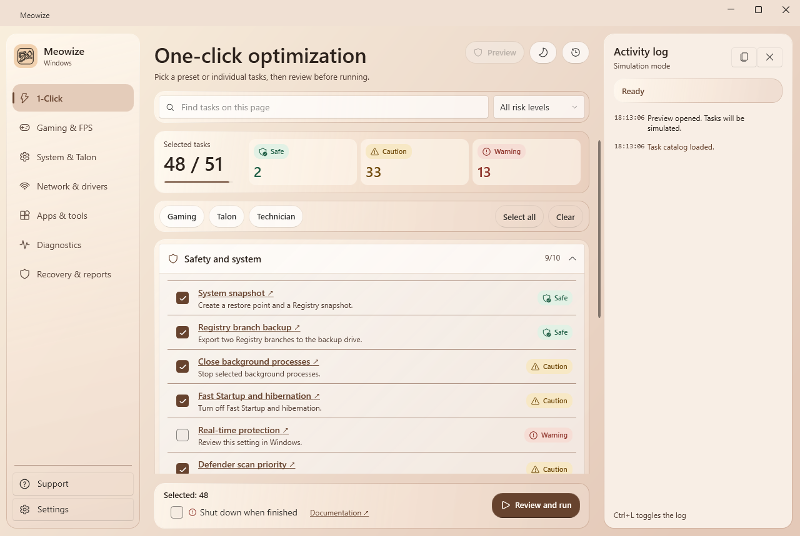

<h1 align="center">
  <a href="https://github.com/Fuzuto/Meowize-Optimize/releases/latest"></a>
</h1>

<p align="center">
  <strong><a href="https://github.com/Fuzuto/Meowize-Optimize/releases/latest">Download for Windows</a></strong>
  &nbsp;·&nbsp; <a href="#quick-start">Quick start</a>
  &nbsp;·&nbsp; <a href="docs/features.en.md">Feature guide</a>
</p>

<p align="center">
  🇺🇸 <strong>English</strong> &nbsp;·&nbsp;
  🇻🇳 <a href="docs/README.vi.md" lang="vi">Tiếng Việt</a> &nbsp;·&nbsp;
  🇯🇵 <a href="docs/README.ja.md" lang="ja">日本語</a> &nbsp;·&nbsp;
  🇰🇷 <a href="docs/README.ko.md" lang="ko">한국어</a> &nbsp;·&nbsp;
  🇨🇳 <a href="docs/README.zh-CN.md" lang="zh-CN">简体中文</a>
</p>

<p align="center">Windows 11 x64 &nbsp;·&nbsp; Portable ZIP &nbsp;·&nbsp; 51 1-Click tasks &nbsp;·&nbsp; 66 standalone tools</p>

Meowize is a free Windows toolkit built to help you tune FPS and frame pacing in games like **VALORANT**, **Counter-Strike 2** and **Overwatch**. Review gaming tweaks, install a graphics driver or your usual apps, and check network settings from the same desktop app.

## Quick start

1. Download the Windows x64 ZIP. [Latest release](https://github.com/Fuzuto/Meowize-Optimize/releases/latest)
2. Extract the entire archive and open `Meowize.exe`. The ZIP includes the .NET Desktop Runtime.
3. Choose your region, open **1-Click**, and select **Gaming**. **Review and run** shows the selected actions and their impact before you confirm.

From PowerShell in the extracted folder, run `.\Meowize.exe --preview` to try the flow with simulated tasks. For real changes, **Recovery & reports → System snapshot** can create a restore point and a Registry backup.

Starting with v1.4.0, select **ⓘ How it works** next to any task to see the button to use, which settings or files it touches, and whether it needs administrator access or a restart. The batch review shows the same changes in run order. [All 117 task descriptions](docs/features.en.md)

## Gaming and FPS

The **Gaming** preset covers **36 of 51** tasks for system setup, gaming, networking and cleanup. Use the individual actions in **Gaming & FPS** when you want to measure one change at a time.

| In the app | What it changes |
| --- | --- |
| **Mouse and keyboard buffers** | Sets `MouseDataQueueSize` and `KeyboardDataQueueSize` to `20`, enables Game Mode for the current account, and requests HAGS with `HwSchMode = 2`. [Microsoft keyboard and mouse class drivers](https://learn.microsoft.com/en-us/windows-hardware/drivers/hid/keyboard-and-mouse-hid-client-drivers) |
| **Unpark CPU cores** | Requests a 100% minimum for unparked cores on the active Windows power plan. [Microsoft core parking documentation](https://learn.microsoft.com/en-us/windows-hardware/customize/power-settings/options-for-core-parking-cpmincores) |
| **FPS Boost profile** | Applies a group of changes that includes a performance power plan and boot settings. Review the **Warning** details before applying it. |
| **Game CPU priority** | Sets CPU priority for a predefined list of game executables, including VALORANT, CS2 and Overwatch. |

To use the buffer tweak on its own, open **Gaming & FPS → Mouse and keyboard buffers**, inspect the details, then choose **Run** and confirm. It is also listed under **1-Click → Gaming and latency**. Restart Windows and check both the mouse and keyboard.


### Measure FPS and frame time

| Target FPS | 60 | 144 | 240 | 360 |
| --- | ---: | ---: | ---: | ---: |
| Time per frame | 16.67 ms | 6.94 ms | 4.17 ms | 2.78 ms |

The table uses `1,000 ÷ FPS`. These are target frame times. For a before-and-after comparison, record the same **60-second** practice route or replay at the same resolution, graphics settings and FPS limit. Change one setting and compare average FPS, 1% lows and frame-time spikes. Track CPU temperature when comparing power plans. [Intel PresentMon](https://github.com/GameTechDev/PresentMon)

## Quick driver and app installs

| Choose an action | What you get |
| --- | --- |
| **Apps & tools → NVIDIA WHQL → Install** | The selected installer downloads from NVIDIA. Meowize checks its publisher signature before launching it. Compare your GPU with NVIDIA’s supported-product list. [581.80 WHQL](https://www.nvidia.com/en-us/drivers/details/257497/) · [566.36 WHQL](https://www.nvidia.com/en-us/drivers/details/237719/) |
| **Apps & tools → Install three apps with WinGet** | Google Chrome, Discord and 7-Zip in one batch. Windows App Installer provides WinGet. [Microsoft WinGet documentation](https://learn.microsoft.com/en-us/windows/package-manager/winget/) |
| **1-Click → Install six apps with WinGet** | The same three apps plus UniKey, UltraViewer and Zalo. |

<details>
<summary>See the driver and app install controls</summary>


</details>

## Network and bufferbloat

**Network & drivers** offers five DNS choices, TCP/IP tuning, adapter power settings and network repair. For example, choose Cloudflare **1.1.1.1 / 1.0.0.1** and select **Apply** to set IPv4 DNS on active adapters. [Cloudflare DNS addresses](https://developers.cloudflare.com/1.1.1.1/ip-addresses/)

Measure bufferbloat by comparing idle latency with latency during an upload or download on the same connection. For example, **18 ms idle** and **74 ms under load** give **+56 ms** of latency under load. For congestion at the router, check whether it supports Smart Queue Management (SQM), then repeat the test after changes. [IETF queue management recommendations](https://datatracker.ietf.org/doc/html/rfc7567)

<details>
<summary>See DNS and adapter settings</summary>


</details>

## Review and personalize

**🟢 Safe** covers lower-impact tasks such as reads and exports. **🟡 Caution** marks changes to settings, files or apps. **🔴 Warning** marks higher-impact actions such as driver updates, boot changes and restarts. Select a task name with **↗** to open its reference.

Meowize checks prerequisites such as the GPU, WinGet and active network adapters. Hover over a dimmed task to see the reason. **Why this is unavailable ↗** opens a relevant guide when available. Presets leave dimmed tasks out.

The region picker starts in English. Change the language in **Settings**, switch themes with the sun or moon button, and choose whether to save your selections when closing with **X** or **Alt+F4**.

<details>
<summary>See the 1-Click dashboard, light theme and region picker</summary>


<p align="center">
  
  
</p>

</details>

## Build from source

Use the .NET 10 SDK on Windows.

```powershell
dotnet publish .\app\AioOptimize.csproj -c Release -r win-x64 --self-contained true -o .\artifacts\Meowize-Windows-x64
pwsh -NoProfile -File .\tests\Smoke-Preview.ps1 -App .\artifacts\Meowize-Windows-x64\Meowize.exe -Screenshots .\artifacts
```

The preview test covers navigation, presets, themes, language switching and simulated tasks.

After editing task descriptions, regenerate the localized feature guides with `pwsh -File .\tools\Update-TaskGuides.ps1`.

## License

Maintained by **Lê Hiếu Trung (FuryZ)**. The MIT license covers new Meowize contributions. [GitHub profile](https://github.com/Fuzuto) · [MIT license](LICENSE)
