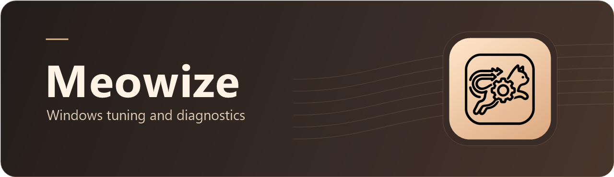
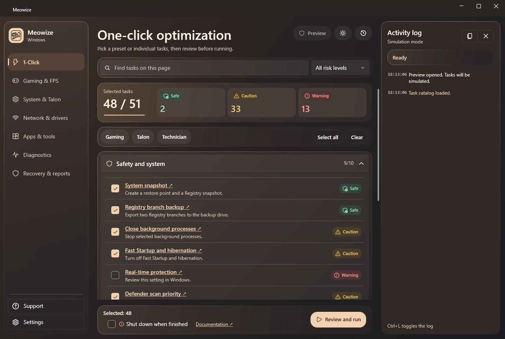
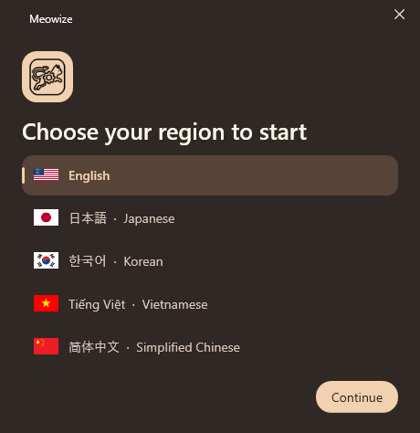

<h1 align="center">
  <a href="https://github.com/Fuzuto/AIO-Optimize/releases/latest"></a>
</h1>

<p align="center">
  <strong><a href="https://github.com/Fuzuto/AIO-Optimize/releases/latest">Download for Windows</a></strong>
  &nbsp;·&nbsp; <a href="#quick-start">Quick start</a>
  &nbsp;·&nbsp; <a href="docs/README.vi.md" lang="vi">Tiếng Việt</a>
</p>

<p align="center">Windows 11 x64 &nbsp;·&nbsp; Portable ZIP &nbsp;·&nbsp; 5 interface languages</p>

Meowize brings Windows tuning, cleanup, diagnostics, and recovery tools into a single desktop app. Select the tasks you want, see their risk levels and references, then review what will run.



## Quick start

1. Download the Windows x64 ZIP in [Latest release](https://github.com/Fuzuto/AIO-Optimize/releases/latest).
2. Extract the entire archive. Open `Meowize.exe` in the extracted folder. The ZIP includes the .NET Desktop Runtime.
3. On first launch, select your region. Choose a preset or individual tasks and select **Review and run** to read the batch before confirming.

Run `.\Meowize.exe --preview` in PowerShell from the extracted folder to explore the app with simulated tasks and separate preferences.

## What you can do

| Area | Included |
| --- | --- |
| **1-Click** | 51 selectable tasks, Gaming, Talon and Technician presets, risk filters, batch review and a live activity log |
| **Windows tools** | 66 standalone actions for gaming, system settings, network and drivers, apps, diagnostics, and recovery |
| **Network** | Five DNS providers with documentation links and a separate **Apply** action |
| **Diagnostics and recovery** | Hardware details, startup management, restore points, Registry backups, and exportable reports |
| **Preferences** | Light and dark themes, a saved region, and the option to save, discard, or remember your choice when closing |

**🟢 Safe** covers low-impact operations such as reads and exports. **🟡 Caution** marks changes to settings, files, or apps. **🔴 Warning** marks higher-impact operations such as driver or security changes and restarts. Task names with ↗ open upstream code, documentation, or a vendor page. Review the notes for each selected task before confirming.

## Languages and themes

🇺🇸 English (default) · 🇯🇵 日本語 · 🇰🇷 한국어 · 🇻🇳 Tiếng Việt · 🇨🇳 简体中文

Switch the language in **Settings**. Use the sun or moon button to change themes. Closing with **X** or **Alt+F4** follows the saved exit preference.

<p align="center">
  
  
</p>

## Build from source

Use the .NET 10 SDK on Windows.

```powershell
dotnet publish .\app\AioOptimize.csproj -c Release -r win-x64 --self-contained true -o .\artifacts\Meowize-Windows-x64
pwsh -NoProfile -File .\tests\Smoke-Preview.ps1 -App .\artifacts\Meowize-Windows-x64\Meowize.exe -Screenshots .\artifacts
```

The preview test covers the interface and simulated tasks. The [task inventory](REDESIGN-PLAN.md) records the original action IDs and mappings.

## Credits and license

Maintained by **Lê Hiếu Trung (FuryZ)**. The task inventory and legacy actions draw from **THPO v1.3** by **Ngô Thanh Hải (Haisosad)**. The MIT license applies to new Meowize contributions. [GitHub profile](https://github.com/Fuzuto) · [MIT license](LICENSE) · [Third-party notices](THIRD-PARTY-NOTICES.txt)
