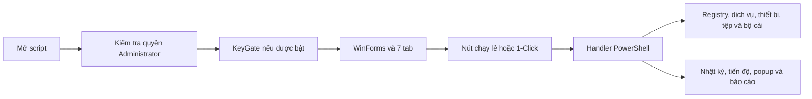

# Kế hoạch thiết kế lại THPO v1.3 Pro Ultimate

Thông tin hỗ trợ, mức độ tác vụ và giấy phép của bản hiện tại được ghi trong [README](README.md). Các dòng về QR bên dưới mô tả thiết kế gốc và kế hoạch ban đầu.

## 1. Phạm vi và bản gốc

- Mã gốc nằm tại [upstream/THPO](upstream/THPO), revision `396552f4cbc20dbaa00cecf0677e68a185f96a66`. Bản clone có 32 commit và một tệp PowerShell, 10.875 dòng. Đã so sánh từng byte với blob của revision và phân tích cú pháp bằng Windows PowerShell 5.1 lẫn PowerShell 7. Cả hai parser đều trả về 0 lỗi.
- Phạm vi kiểm chứng hiện tại là phân tích mã tĩnh. Các nhận định về hiệu lực của từng tweak, quyền và khả năng tương thích sẽ cần kiểm thử trên Windows. Gist được đánh dấu secret và revision này chỉ có mã nguồn, chưa thấy thông tin cấp phép phân phối. Giữ bản tham chiếu trong workspace và giữ ghi công tác giả. [Tài liệu GitHub về Gist](https://docs.github.com/en/get-started/writing-on-github/editing-and-sharing-content-with-gists/creating-gists)
- Mốc đối chiếu gồm **7 trang, 51 bước batch, 1 tùy chọn tắt máy, 62 nút tác vụ riêng đã tạo và 4 handler tác vụ riêng thiếu nút**. Ngoài các nút đó còn có bộ chọn DNS, preset, tùy chọn popup, thông tin máy, nhật ký, liên hệ/QR, hộp thoại Startup và KeyGate. Phụ lục A–C đối chiếu theo ID và dòng nguồn.

### Luồng thực thi hiện tại

WinForms dùng tọa độ cố định 1180 × 860, không có nút phóng to. Nhiều handler chạy đồng bộ và gọi `DoEvents()` từ log, tiến độ hoặc tác vụ Talon. Đây là chỗ cần tách xử lý nền để cửa sổ phản hồi khi cài driver, tải tệp hoặc chạy DISM. Các khối chính nằm ở dòng 149 (khởi động), 293 (KeyGate), 1501 (UI), 3511 (hàm dùng chung), 5175 (checklist), 7149 (preset), 7325 (batch runner) và 7489 (handler chạy lẻ).

### Các chênh lệch đã xác nhận trong mã

| Chỗ đối chiếu | Hành vi gốc | Cách xử lý trong bản mới |
| --- | --- | --- |
| Bốn nút Gaming thiếu | Handler `btnInputQueue`, `btnDisableVBS`, `btnFlipModel`, `btnBlockPresence` gọi `Add_Click` trên biến chưa được gán. Bốn mục batch tương ứng có entry riêng. | Thêm đủ bốn điểm truy cập chạy lẻ. Rà từng handler và kiểm thử cả đường chạy lẻ lẫn batch. |
| Hai cách chạy Talon | Nút Talon đầy đủ có 9 giai đoạn, gồm cả Sticky/Toggle/Filter Keys, tinh chỉnh app nền/Explorer và paging/Power Throttling. Checklist Talon có 9 mục với các bước riêng cho Explorer, dịch vụ và gỡ UWP. Checkbox Sticky Keys nằm ở Gaming. | Đối chiếu hành động thực tế của từng giai đoạn theo dòng 3939 và 6287. |
| FPS Boost và Power Plan | `PowerPlan` trong batch gọi cả `Invoke-FpsBoostProfile` và ghi ưu tiên CPU 26 thập phân. Mục `Win32Pri` ghi 38 ở bước trước đó. Một số mục HAGS, MPO và mạng cũng có phần chồng lấp. | Ghi lại thứ tự và trạng thái cuối, kể cả khi chọn đồng thời. Chỉ dùng chung phần có tham số và tác dụng trùng khớp. |
| Winget và mạng | Winget chạy lẻ cài 3 app, batch cài 6 app. Reset mạng chạy lẻ có thêm release/renew. DNS chạy lẻ flush cache sau khi đổi địa chỉ. `DnsCloud` trong batch chỉ đổi địa chỉ. | Giữ đúng danh sách gói, phạm vi adapter và trình tự cho từng điểm vào. |
| Sao lưu và khôi phục | `RestorePoint` gọi cả snapshot Registry dưới `C:\THPO_Backup`. `BackupReg` xuất hai nhánh con sang `D:\THPO_Backup`, dù nhãn ghi toàn bộ Registry. Restore Registry tìm thư mục mới nhất dưới ổ C và chỉ thử đọc `HKLM.reg`, `HKCU.reg`. | Giữ cả hai định dạng đầu ra và đọc bản C cũ. Hiển thị chính xác phạm vi, đường dẫn và tệp tìm được. Bản xuất nhánh con và snapshot đầy đủ cần được nhận diện đúng. |
| Trạng thái thành công | Batch tăng phần trăm trước khi chạy bước, bắt exception rồi đi tiếp và kết thúc bằng thông báo thành công chung. Nhiều lệnh bỏ qua lỗi hoặc bỏ qua exit code. | Cập nhật tiến độ khi xử lý xong mỗi bước. Ghi kết quả, mã lỗi và trạng thái sau thao tác. Hiển thị thành công khi có bằng chứng, kể cả backup/restore và cài đặt. |
| Windows Update và dọn đĩa | Handler Update đặt dịch vụ về Disabled vô thời hạn. Nhãn gốc ghi “tạm thời”. `CleanSystem` batch xử lý Temp/Prefetch. Disk Cleanup nâng cao xử lý một tập đích riêng. | Dùng nhãn khớp với tác dụng thực tế. Ghi rõ danh sách đích của từng nút trước khi xóa. |
| Khởi động và tải tệp | Một nhánh khởi động tải và thực thi script từ mạng với quyền Administrator. QR tải lúc dựng UI. DDU tải URL đuôi `.exe` nhưng lưu `DDU.zip`. Các bộ cài có ít kiểm chứng trước và sau khi mở. | Điểm vào mới là bản cục bộ đã kiểm chứng, vẫn có luồng UAC. Tải QR ngoài luồng giao diện. Kiểm tra loại tệp, nguồn, nhà phát hành/chữ ký hoặc checksum chính thức khi có, rồi đọc exit code. [Authenticode trên Windows](https://learn.microsoft.com/en-us/powershell/module/microsoft.powershell.security/get-authenticodesignature?view=powershell-5.1) |

## 2. Giao diện và motion

**Hướng thiết kế** là một công cụ Windows gọn, dễ quét khi thao tác liên tục. Nền `#10151D`, bề mặt `#161E29`, chữ chính `#F3F6FB` và chữ phụ `#AAB7C9`. Xanh ngọc `#4DDBC6` đánh dấu thao tác chính, hổ phách `#F6C66F` cho cảnh báo, đỏ `#F47F88` cho lỗi. Dùng Segoe UI cho tiếng Việt, Consolas cho log. Phần giới thiệu máy ưu tiên tên phần cứng và dữ liệu đọc được. Các con số FPS, ping và độ trễ chỉ hiện khi có nguồn đo.

| Khu vực | Bố cục và tương tác |
| --- | --- |
| Khung ứng dụng | Thanh trên hiển thị tên máy/app, trạng thái quyền và nút mở Nhật ký. Điều hướng trái giữ thứ tự 7 trang gốc. Vùng giữa cuộn độc lập. Nhật ký có vùng riêng bên phải ở cửa sổ rộng và mở dạng ngăn bên dưới ở cửa sổ hẹp. Dùng thanh tiêu đề hệ thống để giữ thao tác kéo, phóng to và thu nhỏ chuẩn Windows. |
| 1‑Click | Hiển thị một hàng preset và số tác vụ đang chọn. Checklist có 4 nhóm, mỗi hàng có nhãn, mô tả ngắn và trạng thái hỗ trợ khi biết. Tùy chọn tắt máy đứng cạnh phần tóm tắt. Nút **Xem và chạy** ghim trong vùng thao tác, thay vị trí trên/dưới gọi cùng một handler ở bản gốc. Màn xác nhận cho thấy thứ tự, các tác động, tình trạng sao lưu và yêu cầu khởi động lại. |
| Gaming, Hệ thống, Mạng, Apps | Nhóm theo việc cần làm trong từng trang. Nút chạy lẻ nằm ngay trên từng hàng, giữ cả hai phiên bản NVIDIA và các công cụ riêng. Mạng đặt năm lựa chọn DNS cùng nút Áp dụng. Các tác vụ adapter, reset và UEFI có lời giải thích theo tác động. Startup mở hộp thoại có cột tên, lệnh khởi động, nguồn và checkbox. |
| Dashboard | CPU/GPU/RAM/Windows ở phần đầu, sau đó là kiểm tra phần cứng, ổ đĩa, nhiệt, license, Health Check, tương thích và snapshot. Mỗi kết quả nêu nguồn dữ liệu và thời điểm cập nhật. Thiết bị thiếu cảm biến vẫn hiển thị các số liệu còn đọc được. |
| Cứu hộ và báo cáo | Ưu tiên các nút tạo điểm khôi phục, sao lưu và xem bản dùng để khôi phục. DISM/SFC hiển thị tiến độ theo giai đoạn. HTML, TXT, Clipboard và ZIP là bốn lối xuất riêng, có thông báo vị trí tệp sau khi xong. |
| Nhật ký và hỗ trợ | Nhật ký giữ timestamp và mức độ, cho phép cuộn đọc trong lúc app đang chạy. Tự cuộn khi người dùng ở cuối. Tùy chọn popup mặc định giữ hành vi gốc với thông báo thông tin. Hộp thoại xác nhận vẫn hiện ở những thao tác cần xác nhận. Đưa liên hệ và QR vào mục Hỗ trợ trong khung app. |

| Chuyển động | Thời lượng dự kiến | Tiêu chí |
| --- | --- | --- |
| Hover, nhấn, checkbox | 90–130 ms | Đổi màu/viền hoặc chuyển nhẹ dấu chọn. Focus bàn phím nhìn thấy ngay và trạng thái có nhãn. |
| Chuyển trang hoặc bung chi tiết | 160–200 ms | Fade và dịch tối đa 8 DIP với easing giảm tốc. Nội dung nhận focus ngay sau khi đổi trang. |
| Nhật ký hoặc hộp thoại | 180–220 ms | Fade nhẹ và dịch tối đa 12 DIP. Hộp thoại giữ focus, Escape đóng khi có thể và trả focus đúng control sau khi đóng. |
| Tác vụ đang chạy | Nội suy 140 ms giữa hai giá trị đã nhận | Phần trăm là số bước đã xử lý hoặc số byte tải thực tế. Khi chưa biết tổng, hiện trạng thái đang chạy và tên bước thay vì đoán phần trăm. |
| Giảm chuyển động | 0 ms cho chuyển động trang, panel và progress | Khi tắt Animation effects của Windows, chữ trạng thái, vị trí focus và số tiến độ cập nhật ngay. [Cài đặt animation hệ thống trong WPF](https://learn.microsoft.com/en-us/dotnet/api/system.windows.systemparameters.clientareaanimation?view=netframework-4.8.1) |

Ở chiều rộng từ 1.180 DIP dùng ba vùng. Dưới ngưỡng đó thu gọn Nhật ký. Dưới 960 DIP thu gọn điều hướng và giữ tên mục qua tooltip/lời đọc. Dùng lưới co giãn và xuống dòng cho nhãn dài. Kiểm thử trên 1024 × 768 ở 100%, 1366 × 768 ở 125%, 1920 × 1080 ở 100% và 150%, thêm thao tác kéo cửa sổ qua hai màn hình khác DPI. Kiểm tra luồng từ đầu đến cuối bằng bàn phím, Narrator, High Contrast và Animation effects tắt. Dùng màu hệ thống khi High Contrast bật.

## 3. Kiến trúc triển khai

**WPF/XAML + Windows PowerShell 5.1 x64.** WPF cung cấp layout co giãn, data binding, style và Storyboard. Giữ môi trường PowerShell của điểm vào gốc để đối chiếu các cmdlet Windows và hàm Win32 trước khi cân nhắc chuyển runtime. Dành luồng STA cho giao diện và một runspace cho tác vụ, cập nhật UI qua Dispatcher. [Animation WPF](https://learn.microsoft.com/en-us/dotnet/desktop/wpf/graphics-multimedia/animation-overview?view=netframeworkdesktop-4.8), [mô hình luồng WPF](https://learn.microsoft.com/en-us/dotnet/desktop/wpf/advanced/threading-model)

| Phần | Trách nhiệm |
| --- | --- |
| Điểm vào cục bộ | Mở UI từ release đã được kiểm chứng và giữ nhánh UAC chấp nhận/từ chối. KeyGate mặc định tắt như revision gốc. Khi có cấu hình từ chủ sở hữu, giữ luồng online/offline, ghi nhớ và giới hạn thử qua dữ liệu kiểm thử. Mọi giá trị xác thực thật để ngoài mã và log. |
| XAML và style | Khung cửa sổ, bảy trang, hộp thoại và từ điển style dùng chung. Dữ liệu hệ thống/tiến độ từ binding, nội dung tiếng Việt có dấu. |
| Danh mục tác vụ | Mỗi điểm vào có ID, vị trí, tham số, điều kiện hỗ trợ, hành động, loại tác động, yêu cầu quyền/khởi động lại và cách đọc lại kết quả. Giữ ID batch hiện có. Tác vụ chạy lẻ chung tên có binding riêng khi hành vi khác. |
| Runner | Nhận danh sách ID và tham số hợp lệ từ UI, chụp lại thứ tự lúc xác nhận, chạy tuần tự và gửi sự kiện log/trạng thái. Chặn bấm chạy lần hai trong khi đang chạy. Cho phép dừng giữa hai bước. Khi bước hiện tại cần chạy tới hết, UI ghi rõ trạng thái đó. |
| Adapter Windows và tệp | Đặt truy vấn CIM, xử lý Windows/native, kiểm chứng bộ cài và xuất tệp ngoài luồng UI để dùng được dữ liệu giả trong test. Bắt lỗi PowerShell và mã thoát chương trình. Tác vụ bị Windows hoặc chính sách máy chặn trả trạng thái tương ứng. Kiểm chứng đường dẫn trước khi ghi/xóa và báo rõ tệp bị khóa hay kết quả một phần. |

Mỗi tác vụ có một trong các trạng thái `Chưa chạy`, `Đang chạy`, `Thành công`, `Một phần`, `Không hỗ trợ`, `Bị chính sách chặn`, `Lỗi` và `Đã hủy`. Hiển thị `Cần khởi động lại` khi kết quả yêu cầu. Trang chỉ đọc mở được trong lúc lấy dữ liệu. Nếu một nguồn lỗi, các phần còn lại vẫn hiện dữ liệu đọc được.

Thư mục `app/` dự kiến chứa `Start-THPO.ps1` làm điểm mở, `MainWindow.xaml` và `Theme.xaml` cho giao diện, `Tasks.psm1` cho danh mục và thao tác PowerShell. UI lấy danh mục theo ID và dùng cùng runner cho tác vụ đơn/batch. Bài kiểm thử trong `tests/` đối chiếu ID, preset, thứ tự, tham số và đầu ra. Có thể chia module theo nhóm chức năng sau khi kiểm thử chứng minh ranh giới cần thiết.

### Quy tắc tương thích đề xuất

1. **Chọn đúng, thực thi có xác nhận.** Snapshot/preset mô phỏng đúng các checkbox gốc. Xác nhận trước khi đổi chính sách bảo vệ hoặc cập nhật, thay BCD/driver/adapter, xóa dữ liệu, reset mạng, khôi phục Registry hoặc tắt/khởi động lại máy. Defender, VBS/HVCI và Windows Update vẫn có điểm truy cập và trạng thái riêng. Việc thao tác đi qua quyền, cài đặt và chính sách Windows hỗ trợ. Nếu hệ điều hành giữ nguyên thiết lập, ghi nhận kết quả đó. [Microsoft về thay đổi bị Tamper Protection chặn](https://learn.microsoft.com/en-us/defender-endpoint/troubleshoot-problems-with-tamper-protection)
2. **Đọc được dữ liệu cũ.** Nhận diện `PreOptimize_*`, `Manual_*` và các bản xuất ở ổ D. Giữ mặc định vị trí/tên đầu ra hợp lý như bản gốc, dùng đường dẫn Desktop của Windows để xử lý Desktop chuyển vị trí. Nếu ổ D thiếu, giữ kết quả từng tác vụ và cho người dùng chọn đích có quyền ghi. Hiển thị xong snapshot, thiếu snapshot, bị giới hạn tạo lại hoặc lỗi ghi tệp. [Giới hạn của Checkpoint-Computer](https://learn.microsoft.com/en-us/powershell/module/Microsoft.PowerShell.Management/checkpoint-computer?view=powershell-5.1)
3. **Bảo toàn phạm vi của từng nút.** Giữ cách áp dụng DNS của từng đường chạy và xác nhận rõ danh sách adapter. Giữ các gói Winget, phiên bản driver và trình tự DISM rồi SFC của bản gốc. Báo thiếu thiết bị phù hợp, WinGet, cảm biến, quyền, hỗ trợ UEFI hoặc internet theo điều kiện đã kiểm tra của từng tác vụ.
4. **Hiển thị kết quả thực tế.** Cho xem đối tượng bị tác động trước tác vụ khó hoàn nguyên. Khi sao lưu thất bại, giữ thông báo lỗi và phương án xử lý trước bước tiếp theo. Hẹn tắt máy giữ mặc định tắt và countdown 45 giây sau khi kết thúc batch đủ điều kiện. Bản mới cho phép hủy countdown và hỏi lại nếu batch lỗi một phần. Báo cáo ZIP giữ nội dung cũ và báo rõ gói có thông tin cấu hình mạng.

## 4. Trình tự xây dựng và nghiệm thu

| Mốc | Việc làm | Điều kiện xong |
| --- | --- | --- |
| 1. Chốt hành vi revision gốc | Tạo bảng ánh xạ kiểm thử từ Phụ lục A–C. Lưu mẫu input, thứ tự, tham số, đường dẫn/định dạng và kết quả mong đợi cho từng đường chạy. Chuẩn bị Windows VM có snapshot và fixture backup cũ. | Bộ so sánh phát hiện thiếu action, checkbox, binding, preset, thứ tự hoặc điểm vào. Bao gồm 4 handler thiếu nút và mọi chức năng ngoài tab. |
| 2. Dựng ứng dụng và motion với dữ liệu giả | Dựng khung WPF, 7 trang, 52 checkbox, 5 thao tác chọn/preset, ngăn nhật ký, confirm, Startup và KeyGate. Nối các tác vụ giả lập đủ thành công, lỗi, một phần, bị chặn và cần reboot. | Tất cả thao tác mô phỏng mở được, có label và focus, UI vẫn kéo/cuộn được khi tác vụ giả lập chạy dài, giảm chuyển động được bằng cài đặt Windows. |
| 3. Nối phần chỉ đọc và xuất tệp | Nối truy vấn hệ thống, Health Check, DNS hiện tại khi có, log, thông tin hỗ trợ, đọc backup và 4 lối xuất. So sánh nội dung báo cáo và ZIP với định dạng gốc. Kiểm thử dữ liệu thiếu. | Đọc được dữ liệu có sẵn khi máy thiếu cảm biến, nhận diện được thư mục backup cũ, xuất đúng HTML/TXT/clipboard/ZIP. Mất mạng chỉ ảnh hưởng phần phụ thuộc mạng. |
| 4. Nối tác vụ ghi và batch | Bắt đầu với sao lưu/phục hồi, tiếp theo là gaming/hệ thống, mạng và dọn dẹp, bộ cài, sửa hệ thống, rồi reboot/UEFI và shutdown. Đối chiếu từng điểm chạy lẻ trước khi ghép preset. | Snapshot VM trước mỗi nhóm. So sánh trước/sau Registry, BCD, dịch vụ, power plan, adapter, AppX và tệp khi áp dụng. Test bấm đúp, từ chối UAC, đúng tài khoản cho thao tác HKCU, lỗi giữa batch, mất mạng, retry và chạy lại từ trạng thái đã đổi. |
| 5. Kiểm thử hoàn chỉnh | Chạy toàn bộ ma trận trên Windows 10/11 x64, ghi rõ edition/build và thiết bị. Thử có và không có ổ D, NIC hỗ trợ và không hỗ trợ, thiếu Winget, UAC từ chối, máy offline, Desktop chuyển vị trí. Kiểm tra riêng driver/DDU, HPET/MSI/HAGS và UEFI trên máy thử phù hợp. | Mỗi mục có kết quả đối chiếu và bằng chứng. Chụp màn hình đủ các mức DPI, test trạng thái lỗi và quyền, thao tác bàn phím và giảm chuyển động. Tác vụ phụ thuộc phần cứng chưa chạy được phải mang trạng thái `Chưa xác minh`. |
| 6. Chuẩn bị bản cục bộ | Gói launcher, XAML, module và tài nguyên theo một revision. Kèm cách mở app, xem log và nhận diện bản backup. | Thử mở gói từ thư mục có dấu và khoảng trắng, qua UAC và khi offline. Gói có revision, bảng kiểm thử, giới hạn tương thích đã biết và ghi công tác giả. |

**Kiểm thử hồi quy trọng tâm**

- Kiểm tra cả tập ID lẫn số lượng trong bảng preset. Năm thao tác chọn/preset giữ nguyên tùy chọn tắt máy. Một batch rỗng không chạy. Từ chối xác nhận không ghi hệ thống. Thứ tự theo bảng A, kể cả nhóm Hệ thống có thứ tự handler khác vị trí checkbox.
- So sánh từng đường chạy Talon, FPS Boost/Power Plan/ưu tiên CPU, DNS, reset mạng, sao lưu Registry, Winget 3 và 6 gói, Hibernate và hai bản NVIDIA. Đọc lại trạng thái cuối khi nhiều mục chạm cùng thiết lập.
- Kiểm thử trên máy thiếu ổ D, backup rỗng/hỏng, tệp bị khóa, đường dẫn có dấu hoặc khoảng trắng, mạng ngắt khi đang tải, tệp sai loại/nhà phát hành, chương trình trả mã lỗi, NIC thiếu tùy chọn, WMI/ổ đĩa thiếu dữ liệu và máy bị quản lý.
- Health Check hiện tính từ ổ C và phần trăm RAM. Mục SMART đọc `HealthStatus` từ `Get-PhysicalDisk`. Nhiệt độ đến từ vùng ACPI. Kiểm tra Xeon/Ryzen/Intel suy luận từ tên CPU. Bản mới ghi rõ các nguồn này. Khi đo hiệu năng, dùng cấu hình và kịch bản chơi cố định rồi đối chiếu frametime/1% low, nhiệt và điện năng trước/sau.

## Phụ lục A — 51 mục 1‑Click theo thứ tự chạy

Thứ tự lấy từ `$script:batchChecklist`. Cột Nhóm dùng tên hiển thị. Tên nhóm dùng tính preset nằm ở bảng kế tiếp. Chữ “Tắt” ở cột mặc định chỉ trạng thái checkbox lúc mở app.

| ID | Nhóm | Phạm vi hành động | Mặc định | Dòng THPO |
| --- | --- | --- | --- | ---: |
| `RestorePoint` | Hệ thống | Điểm khôi phục và snapshot Registry dưới ổ C | Bật | 5187 |
| `BackupReg` | Hệ thống | Xuất hai nhánh Registry dưới ổ D | Bật | 5207 |
| `KillBloat` | Hệ thống | Dừng các tiến trình nền trong danh sách | Bật | 5255 |
| `Hibernate` | Hệ thống | Tắt Fast Startup và Hibernate | Bật | 5272 |
| `Defender` | Hệ thống | Quản lý Defender và bảo vệ thời gian thực | Tắt | 5288 |
| `WinUpdate` | Hệ thống | Quản lý tự động cập nhật Windows | Bật | 5324 |
| `DefenderCpu` | Hệ thống | Giảm tải CPU khi Defender quét | Bật | 5362 |
| `SysMain` | Hệ thống | Tắt dịch vụ SysMain | Bật | 5382 |
| `Telemetry` | Hệ thống | Điều chỉnh dịch vụ chẩn đoán và telemetry | Bật | 5402 |
| `DebloatUWP` | Hệ thống | Gỡ danh sách UWP mặc định, xử lý gaming overlay | Bật | 5438 |
| `InputQueue` | Gaming | Buffer chuột/phím, Game Mode và HAGS | Bật | 5504 |
| `DisableVBS` | Gaming | Quản lý VBS/Memory Integrity, cần kiểm tra sau reboot | Bật | 5548 |
| `FlipModel` | Gaming | DirectX Flip Model khi chơi dạng cửa sổ | Bật | 5570 |
| `BlockPresence` | Gaming | Game Bar Presence và thông báo gaming overlay | Bật | 5592 |
| `PriorityGame` | Gaming | Ưu tiên CPU cho danh sách game gốc | Bật | 5636 |
| `HPET` | Gaming | Thiết bị HPET và cấu hình timer | Bật | 5656 |
| `Win32Pri` | Gaming | Ưu tiên CPU và timer BCD | Bật | 5673 |
| `MPO` | Gaming | Cấu hình Multiplane Overlay | Bật | 5691 |
| `Fullscreen` | Gaming | Fullscreen Optimizations và thiết lập Game DVR đi kèm | Bật | 5727 |
| `MSIMode` | Gaming | Chế độ interrupt MSI của GPU và NIC | Bật | 5887 |
| `HAGS` | Gaming | Hardware Accelerated GPU Scheduling | Bật | 5947 |
| `PowerPlan` | Gaming | Toàn bộ profile FPS Boost, gồm power plan | Bật | 5967 |
| `UnparkCore` | Gaming | Core parking của power plan hiện tại | Bật | 5987 |
| `DisableULPS` | Gaming | ULPS, giới hạn PCIe/power liên quan | Bật | 6007 |
| `MouseAim` | Gaming | Tắt tăng tốc chuột | Bật | 6027 |
| `TscSync` | Gaming | Đồng bộ TSC | Bật | 6067 |
| `KernelRam` | Gaming | Cấu hình paging cho kernel | Bật | 6099 |
| `Multimedia` | Gaming | Thiết lập multimedia scheduler | Bật | 6135 |
| `TdrDelay` | Gaming | Delay phục hồi GPU (TDR) | Bật | 6211 |
| `StickyFix` | Gaming | Sticky Keys, Toggle Keys và Filter Keys | Bật | 6243 |
| `Talon1` | Talon | Telemetry, dữ liệu chẩn đoán, Activity History, WPBT | Bật | 6287 |
| `Talon2` | Talon | Copilot, Recall, Paint AI và Notepad AI | Bật | 6327 |
| `Talon3` | Talon | Consumer Features và Delivery Optimization | Bật | 6371 |
| `Talon4` | Talon | Menu chuột phải cổ điển | Bật | 6407 |
| `Talon5` | Talon | This PC, Gallery, Home và thiết lập Explorer | Bật | 6439 |
| `Talon6` | Talon | Bing Search, Widgets và đề xuất trong Start | Bật | 6475 |
| `Talon7` | Talon | Các scheduled task trong danh sách | Bật | 6515 |
| `Talon8` | Talon | Dịch vụ chẩn đoán, SysMain và Windows Search | Bật | 6595 |
| `Talon9` | Talon | Danh sách UWP riêng của Talon | Bật | 6639 |
| `SpeedUI` | Talon | Độ trễ menu và End Task trên taskbar | Bật | 6711 |
| `NetLatency` | Mạng và dọn dẹp | Large Send Offload và Green Ethernet | Bật | 6753 |
| `TCPGaming` | Mạng và dọn dẹp | Tham số TCP của các interface | Bật | 6782 |
| `NetPower` | Mạng và dọn dẹp | Tiết kiệm điện của adapter mạng | Bật | 6801 |
| `DnsCloud` | Mạng và dọn dẹp | Cloudflare trên adapter đang Up | Bật | 6821 |
| `ResetNet` | Mạng và dọn dẹp | Flush DNS, Winsock và TCP/IP reset | Bật | 6861 |
| `CleanSystem` | Mạng và dọn dẹp | User Temp, Windows Temp và Prefetch | Bật | 6901 |
| `CleanRiot` | Mạng và dọn dẹp | Cache, log/crash và Riot Client Data thuộc phạm vi handler | Bật | 6941 |
| `ShaderCache` | Mạng và dọn dẹp | Cache shader NVIDIA, AMD và Direct3D | Bật | 6961 |
| `PurgeRAM` | Mạng và dọn dẹp | Thu gọn working set bằng API Win32 | Bật | 7017 |
| `WingetApps` | Mạng và dọn dẹp | Chrome, Discord, 7‑Zip, UniKey, UltraViewer và Zalo | Tắt | 7053 |
| `SfcDism` | Mạng và dọn dẹp | DISM RestoreHealth rồi SFC | Tắt | 7105 |

**Quy tắc preset gốc**

| Chế độ | Số bước chọn | Quy tắc |
| --- | ---: | --- |
| Mở app | 48 | Tắt `Defender`, `WingetApps`, `SfcDism`. |
| Chọn tất cả | 51 | Chọn mọi ID trong checklist. |
| Bỏ chọn | 0 | Bỏ chọn mọi ID trong checklist. |
| Gaming | 36 | Chọn nhóm `Safe_Core`, `Gaming`, `Network`, `Clean`. |
| Talon | 23 | Chọn `Safe_Core`, `Talon`, `Clean` và thêm `Hibernate`, `WinUpdate`. |
| Chuẩn KTV | 48 | Chọn tất cả trừ `Defender`, `WingetApps`, `SfcDism`. |

Checkbox `chkAutoShutdown` ở dòng 2841, mặc định tắt và được điều khiển riêng. Runner đọc checkbox sau vòng lặp và đặt lịch tắt máy sau 45 giây nếu được chọn. Hai nút gốc ở dòng 7473 và 7477 gọi cùng runner. Bảng trên đếm ID thực thi vì phần chú thích nguồn ghi các số lượng khác nhau.

## Phụ lục B — Các nút chạy lẻ

Dòng dưới đây là nơi handler được gắn. Các mục có nhãn “thiếu nút” đã có thân handler trong script.

| Trang | Binding gốc | Tác vụ | Dòng THPO |
| --- | --- | --- | ---: |
| Gaming | `btnFpsBoost` | Chạy profile FPS Boost đầy đủ | 7489 |
| Gaming | `btnKernelRam` | Tinh chỉnh paging kernel | 7505 |
| Gaming | `btnTscSync` | TSC và timer BCD | 7537 |
| Gaming | `btnStickyFix` | Sticky/Toggle/Filter Keys | 7573 |
| Gaming | `btnHPETDevMgr` | HPET qua thiết bị và BCD | 7605 |
| Gaming | `btnUnparkCore` | Unpark CPU | 7621 |
| Gaming | `btnGamePriority` | Ưu tiên các game trong danh sách | 7641 |
| Gaming | `btnMPO` | Bật/tắt MPO theo trạng thái | 7657 |
| Gaming | `btnMSIMode` | MSI cho GPU và adapter mạng | 7705 |
| Gaming | `btnHAGS` | Bật HAGS | 7773 |
| Gaming | `btnShaderCache` | Dọn shader cache | 7789 |
| Gaming | `btnFullscreenOpt` | Fullscreen Optimizations và Game DVR | 7849 |
| Gaming | `btnTimerRes` | Timer và multimedia scheduler | 7985 |
| Gaming | `btnMouseFix` | Tắt tăng tốc chuột | 8045 |
| Gaming | `btnClearRiotLog` | Dọn cache/log Riot | 8069 |
| Gaming | `btnKillBloat` | Dừng tiến trình nền | 8085 |
| Gaming, thiếu nút | `btnInputQueue` | Buffer chuột/phím, Game Mode và HAGS | 10555 |
| Gaming, thiếu nút | `btnDisableVBS` | Quản lý VBS/HVCI | 10597 |
| Gaming, thiếu nút | `btnFlipModel` | Flip Model | 10617 |
| Gaming, thiếu nút | `btnBlockPresence` | Game Bar Presence và gaming overlay | 10637 |
| Hệ thống | `btnTalonFull` | Chạy 9 giai đoạn của Talon đầy đủ | 8113 |
| Hệ thống | `btnClassicMenu` | Menu chuột phải cổ điển | 8145 |
| Hệ thống | `btnDisableULPS` | Áp dụng thiết lập ULPS và power liên quan | 8169 |
| Hệ thống | `btnEnableDefender` | Bật lại Defender | 8185 |
| Hệ thống | `btnDisableDefender` | Quản lý tắt Defender | 8241 |
| Hệ thống | `btnDefenderCpu` | Giới hạn tải CPU khi Defender quét | 10675 |
| Hệ thống | `btnSysMain` | Tắt SysMain | 10693 |
| Hệ thống | `btnFastStartup` | Tắt Fast Startup và Hibernate | 10711 |
| Hệ thống | `btnTelemetry` | Dịch vụ nền và telemetry | 8309 |
| Hệ thống | `btnRemoveBloat` | Gỡ danh sách AppX mặc định | 8381 |
| Hệ thống | `btnClearRam` | Dọn working set và so sánh RAM | 8509 |
| Hệ thống | `btnClearTemp` | Dọn Temp/cache/Prefetch | 8581 |
| Hệ thống | `btnDiskCleanAdv` | Dọn đĩa nâng cao và thống kê dung lượng | 8657 |
| Hệ thống | `btnHibernate` | Bật/tắt Hibernate theo trạng thái | 8777 |
| Hệ thống | `btnStartupMgr` | Liệt kê Registry Run của máy/người dùng và xóa mục bỏ chọn khi áp dụng | 8845 |
| Hệ thống | `btnWinUpdate` | Quản lý tự động cập nhật Windows | 8817 |
| Mạng và Driver | `btnNetPowerOpt` | Tiết kiệm điện NIC | 9097 |
| Mạng và Driver | `btnDeepPing` | Tinh chỉnh TCP/IP | 9113 |
| Mạng và Driver | `btnNetLatency` | Large Send Offload và Green Ethernet | 10729 |
| Mạng và Driver | `btnApplyDns` | Áp dụng DNS đã chọn cho adapter Up và flush DNS | 9153 |
| Mạng và Driver | `btnFlushDns` | Flush DNS cache | 9221 |
| Mạng và Driver | `btnResetNetwork` | Reset mạng với release/renew và xác nhận | 9241 |
| Mạng và Driver | `btnDDU` | Tải và mở DDU 18.0.8.6 | 9281 |
| Mạng và Driver | `btnBios` | Xác nhận và khởi động lại vào firmware | 9329 |
| Apps và Tools | `btnDriverNvidia581` | Tải, cài ngầm NVIDIA 581.80 WHQL | 9361 |
| Apps và Tools | `btnDriverNvidia566` | Tải, cài ngầm NVIDIA 566.36 WHQL | 9429 |
| Apps và Tools | `btnAppsDesktop` | Tải, giải nén vào `THPO_Tools` và mở CPU‑Z/HWMonitor x64 | 9497 |
| Apps và Tools | `btnUnparkApp` | Tải, giải nén và mở Unpark CPU App | 9589 |
| Apps và Tools | `btnInstallCpp` | Tải và cài Visual C++ x64 | 9641 |
| Apps và Tools | `btnPostInstall` | Winget cho Chrome, Discord, 7‑Zip | 9681 |
| Apps và Tools | `btnOfficeTools` | Mở công cụ cấu hình triển khai Office | 9721 |
| Dashboard | `btnScanHardware` | Quét thông tin CPU, GPU, RAM và ổ hệ thống | 9749 |
| Dashboard | `btnSmartCheck` | Tình trạng, loại và dung lượng ổ vật lý | 9817 |
| Dashboard | `btnTempCheck` | Nhiệt độ theo vùng ACPI/WMI | 9889 |
| Dashboard | `btnLicenseCheck` | Đọc trạng thái kích hoạt Windows và thông tin khóa rút gọn | 9941 |
| Dashboard | `btnRunHealthCheck` | Điểm và vấn đề theo dung lượng ổ C/RAM | 10001 |
| Dashboard | `btnHardwareCompat` | Nhận diện Xeon/Ryzen/Intel và hiển thị lưu ý | 10073 |
| Dashboard | `btnSystemSnapshot` | Tạo restore point kèm snapshot Registry | 10117 |
| Cứu hộ và báo cáo | `btnCreatePoint` | Tạo riêng restore point | 10141 |
| Cứu hộ và báo cáo | `btnBackupSys` | Sao lưu Registry dạng `Manual_*` | 10181 |
| Cứu hộ và báo cáo | `btnRestoreReg` | Khôi phục snapshot Registry sau xác nhận | 10213 |
| Cứu hộ và báo cáo | `btnRepair` | Sửa hệ thống theo thứ tự DISM rồi SFC | 10265 |
| Cứu hộ và báo cáo | `btnExportHtml` | Tạo và mở `THPO_System_Report.html` | 10297 |
| Cứu hộ và báo cáo | `btnExportLog` | Lưu `THPO_Log_yyyyMMdd_HHmmss.txt` | 10453 |
| Cứu hộ và báo cáo | `btnCopyLog` | Sao chép nội dung log | 10473 |
| Cứu hộ và báo cáo | `btnDiagZip` | `THPO_Diagnostic.zip` gồm systeminfo, ipconfig và log | 10489 |

## Phụ lục C — Các điểm vào và dữ liệu ngoài danh sách nút

| Phần | Hành vi cần đưa vào kiểm thử | Dòng THPO |
| --- | --- | ---: |
| Điểm vào Administrator | Kiểm tra quyền và UAC. Ở nguồn, nhánh khởi động phân biệt bối cảnh có đường dẫn file và không có. Kiểm thử cả từ chối quyền và mở lại từ file cục bộ. | 149 |
| KeyGate | Mặc định tắt. Nếu bật, có online/offline, token ghi nhớ theo người dùng, tùy chọn ghi nhớ được chọn sẵn, hiện/ẩn mật khẩu, Enter, rời hộp thoại, sao chép liên hệ và giới hạn 5 lần sai. | 349 |
| Trạng thái chính | Thông tin CPU/GPU/RAM/Windows khi mở, thanh trạng thái, tiến độ, log màu có giờ, thông báo bắt đầu và yêu cầu reboot. | 1793 |
| Popup | Checkbox ẩn popup mặc định bật. `Show-Popup` đọc checkbox. `Confirm-Action` có xử lý riêng. | 1933 |
| Liên hệ/QR | Liên hệ tác giả, thông tin đóng góp và QR tải qua mạng. Kiểm thử hiện ảnh và trạng thái ảnh không tải được. | 2073 |
| Bộ chọn DNS | Cloudflare mặc định, Google, Quad9, AdGuard, OpenDNS. Giữ thứ tự, hai địa chỉ mỗi mục và hành động Áp dụng độc lập với thay đổi lựa chọn. | 3295 |
| Thư mục backup | Bản gốc tạo `C:\THPO_Backup` lúc khởi tạo. Kiểm tra quyền ghi và nhận diện lại thư mục này khi nối luồng sao lưu/phục hồi. | 3503 |
| Startup | Danh sách đến từ hai nhánh Registry Run. Mục bỏ chọn sẽ bị xóa khi áp dụng, vì vậy màn xác nhận phải nêu đúng tên và nguồn. | 9029 |
| Sẵn sàng | Giao diện hiện trạng thái sẵn sàng và đọc thông tin máy. Giữ đường vào 1‑Click, log và thông tin phiên bản. | 10757 |
