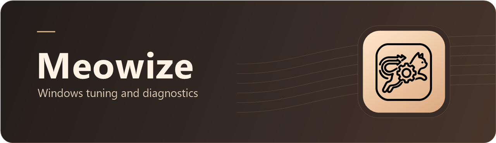
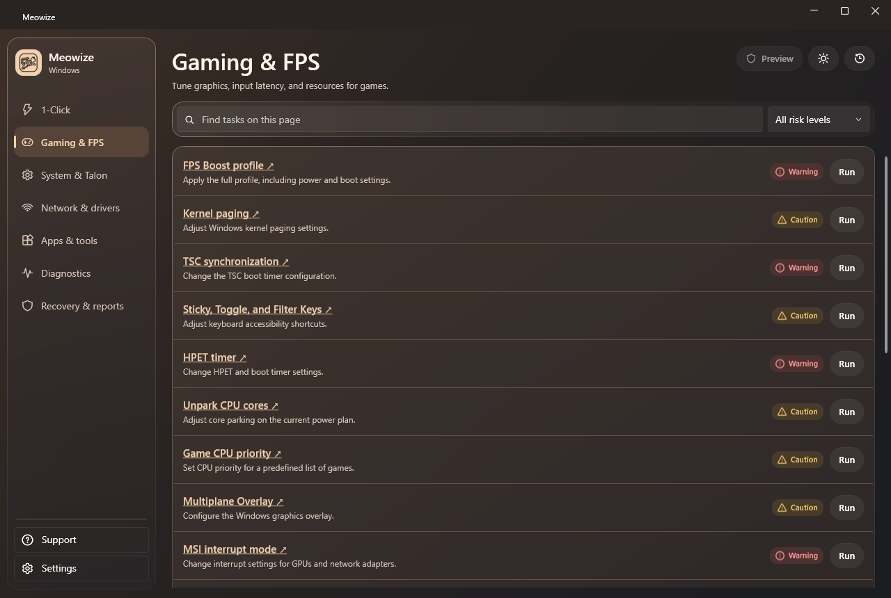
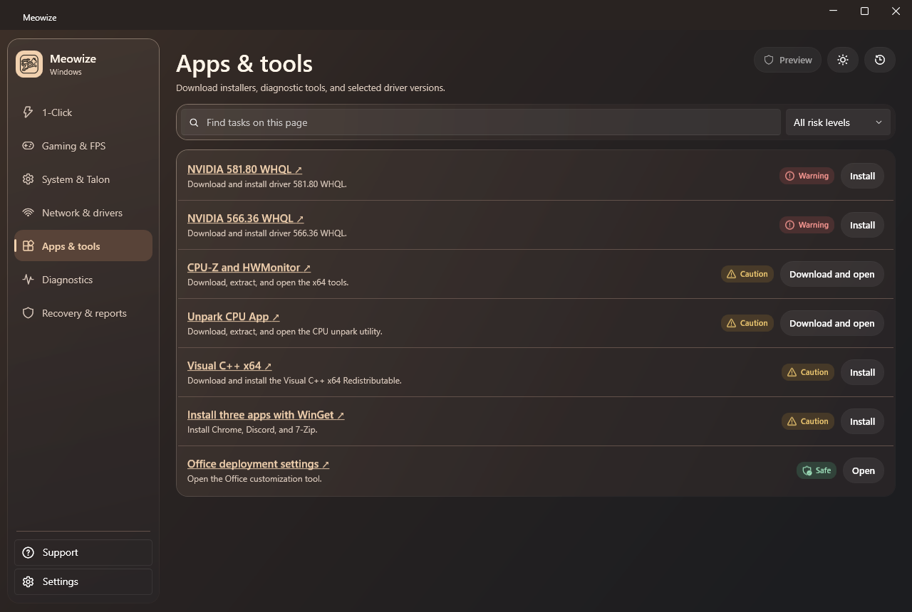
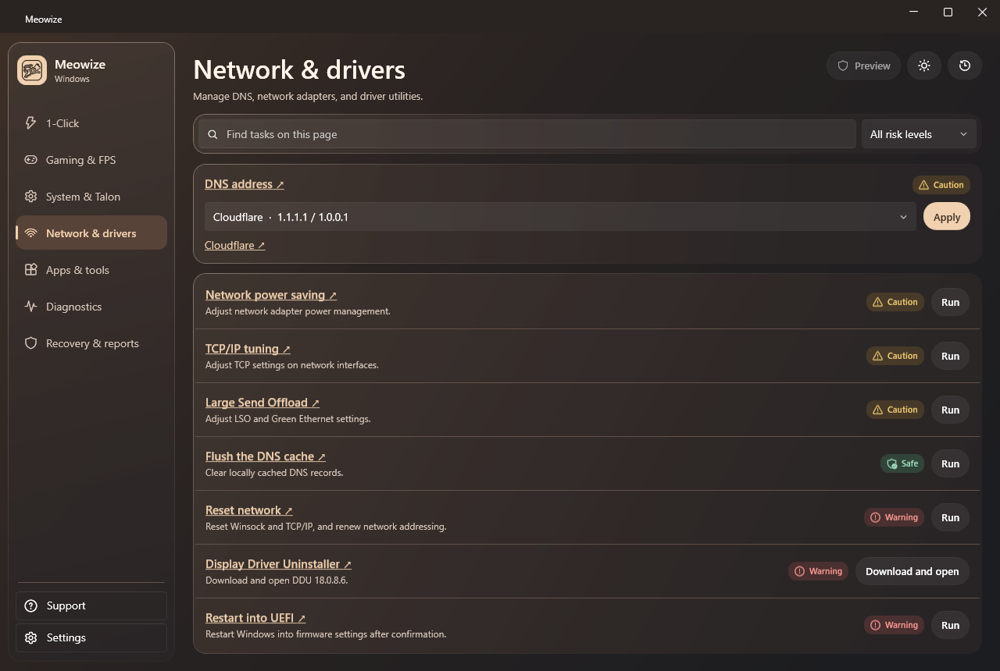

<h1 align="center">
  
</h1>

🇺🇸 [English](../README.md) · 🇻🇳 [Tiếng Việt](README.vi.md) · 🇯🇵 **日本語** · 🇰🇷 [한국어](README.ko.md) · 🇨🇳 [简体中文](README.zh-CN.md)

**Windows 11 x64** · ポータブル ZIP · **1-Click の 51 項目** · **66 種類の個別ツール**

Meowize は、**VALORANT**、**Counter-Strike 2**、**Overwatch** などで FPS やフレーム時間を調整したい人向けの無料 Windows ツールです。ゲーム向けの設定、ドライバーやアプリの導入、ネットワークの調整をひとつの画面で確認できます。

## はじめに

1. Windows x64 用 ZIP をダウンロードします。[最新リリース](https://github.com/Fuzuto/Meowize-Optimize/releases/latest)
2. ZIP 全体を展開し、`Meowize.exe` を起動します。.NET Desktop Runtime は同梱されています。
3. 地域を選び、**1-Click** で **Gaming** を選択します。**確認して実行** で各項目とその影響を確認できます。

展開先の PowerShell から `.\Meowize.exe --preview` を実行すると、操作をシミュレーションできます。実際に変更する前に、**回復とレポート → システムスナップショット** から復元ポイントとレジストリのバックアップを作成できます。

v1.4.0 以降では、各項目の **ⓘ 動作の詳細** から操作手順、変更する設定やファイル、管理者権限や再起動の要否を確認できます。一括実行の確認画面にも実行順に表示されます。[全 117 項目のガイド](features.ja.md)

## ゲームと FPS

**Gaming** プリセットは **51 項目のうち 36 項目** が対象です。個別の効果を測るには **ゲームと FPS** で項目をひとつずつ試せます。

| アプリ内の項目 | 内容 |
| --- | --- |
| **マウスとキーボードのバッファー** | `MouseDataQueueSize` と `KeyboardDataQueueSize` を `20` に設定します。このユーザーのゲーム モードを有効にし、`HwSchMode = 2` で HAGS を要求します。[Microsoft の入力クラス ドライバー解説](https://learn.microsoft.com/en-us/windows-hardware/drivers/hid/keyboard-and-mouse-hid-client-drivers) |
| **CPU コアパーキングを解除** | 使用中の電源プランで、パーキングされないコアの最小割合を 100% に設定します。[Microsoft のコアパーキング解説](https://learn.microsoft.com/en-us/windows-hardware/customize/power-settings/options-for-core-parking-cpmincores) |
| **FPS Boost プロファイル** | パフォーマンス向けの電源設定と起動設定を含む変更をまとめて適用します。事前に **警告** の詳細を確認してください。 |
| **ゲームの CPU 優先度** | VALORANT、CS2、Overwatch など、定義済みのゲーム実行ファイルの CPU 優先度を設定します。 |

個別に実行する場合は **ゲームと FPS → マウスとキーボードのバッファー** を開き、詳細を確認してから **実行** を選びます。**1-Click → ゲームと遅延** にもあります。Windows を再起動してマウスとキーボードを確認してください。

### FPS とフレーム時間を測る

| 目標 FPS | 60 | 144 | 240 | 360 |
| --- | ---: | ---: | ---: | ---: |
| 1 フレームの時間 | 16.67 ms | 6.94 ms | 4.17 ms | 2.78 ms |

表は `1,000 ÷ FPS` で求めた目安です。変更の前後で、同じ練習コースやリプレイを同じ解像度、画質、FPS 上限で **60 秒間** 計測します。設定をひとつ変えて、平均 FPS、1% low、フレーム時間の急増を比較します。電源プランを比較するときは CPU 温度も記録します。[Intel PresentMon](https://github.com/GameTechDev/PresentMon)

## ドライバーとアプリをすばやく導入

| 操作 | 内容 |
| --- | --- |
| **アプリとツール → NVIDIA WHQL → インストール** | NVIDIA から選択したインストーラーを取得し、署名を検証してから実行します。対応製品一覧で GPU を確認できます。[581.80 WHQL](https://www.nvidia.com/en-us/drivers/details/257497/) · [566.36 WHQL](https://www.nvidia.com/en-us/drivers/details/237719/) |
| **アプリとツール → WinGet で 3 本のアプリを導入** | Google Chrome、Discord、7-Zip を一括導入します。WinGet は Windows のアプリ インストーラーに含まれます。[WinGet のドキュメント](https://learn.microsoft.com/en-us/windows/package-manager/winget/) |
| **1-Click → WinGet で 6 本のアプリを導入** | 上記 3 本に UniKey、UltraViewer、Zalo を追加します。 |

インストール画面を見る

## ネットワークとバッファブロート

**ネットワークとドライバー** では DNS を 5 種類から選び、TCP/IP、アダプターの省電力設定、ネットワークのリセットなどを操作できます。たとえば Cloudflare **1.1.1.1 / 1.0.0.1** を選んで **適用** を押すと、使用中のアダプターに IPv4 DNS を設定します。[Cloudflare の DNS アドレス](https://developers.cloudflare.com/1.1.1.1/ip-addresses/)

バッファブロートを確認するには、同じ回線で通信が少ないときとアップロードまたはダウンロード中の遅延を比較します。たとえば **18 ms** が負荷時に **74 ms** なら増加は **+56 ms** です。ルーターで混雑が起きている場合は、Smart Queue Management（SQM）の対応状況を確認し、調整後にもう一度測定します。[IETF のキュー管理に関する推奨事項](https://datatracker.ietf.org/doc/html/rfc7567)

DNS とアダプターの設定画面を見る

## 確認と設定

**🟢 安全** は読み取りやエクスポートなど影響の小さい操作、**🟡 注意** は設定やファイルなどの変更、**🔴 警告** はドライバーの変更、起動設定、再起動などを示します。項目名の **↗** から関連資料を開けます。

Meowize は GPU、WinGet、使用中のネットワークアダプターなどを確認します。グレー表示された項目にカーソルを合わせると理由が表示されます。**利用できない理由 ↗** がある場合は関連ガイドを開けます。グレー表示の項目はプリセットの選択対象から外れます。

初回の地域選択では英語が選ばれています。言語は **設定** で変更でき、太陽または月のボタンでテーマを切り替えられます。**X** と **Alt+F4** では終了時の保存設定が適用されます。

## ビルドとライセンス

Windows の .NET 10 SDK を使います。[ビルドとテストの手順](../README.md#build-from-source)

メンテナーは **Lê Hiếu Trung (FuryZ)** です。MIT ライセンスは Meowize への新規の貢献に適用されます。[GitHub](https://github.com/Fuzuto) · [MIT ライセンス](../LICENSE)
