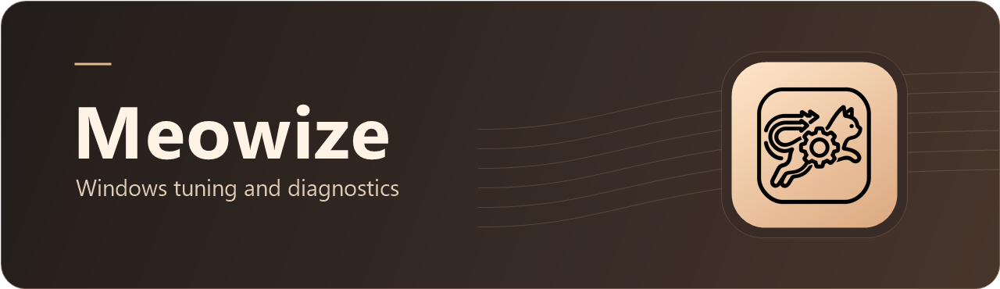
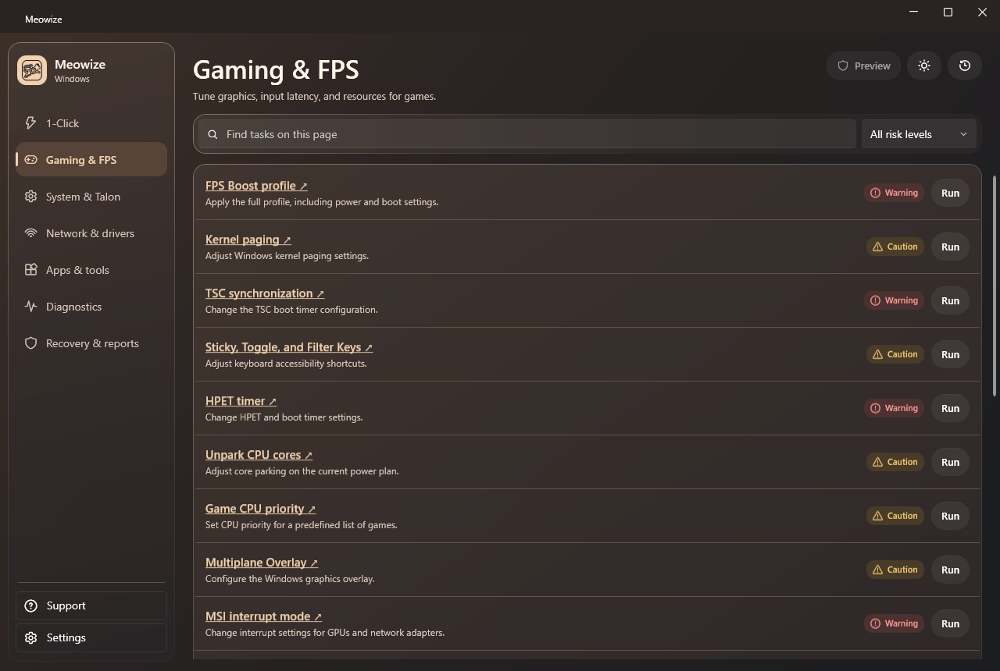
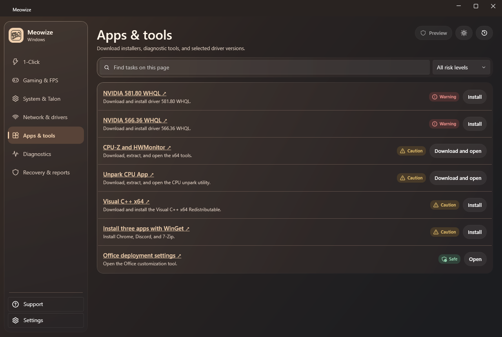
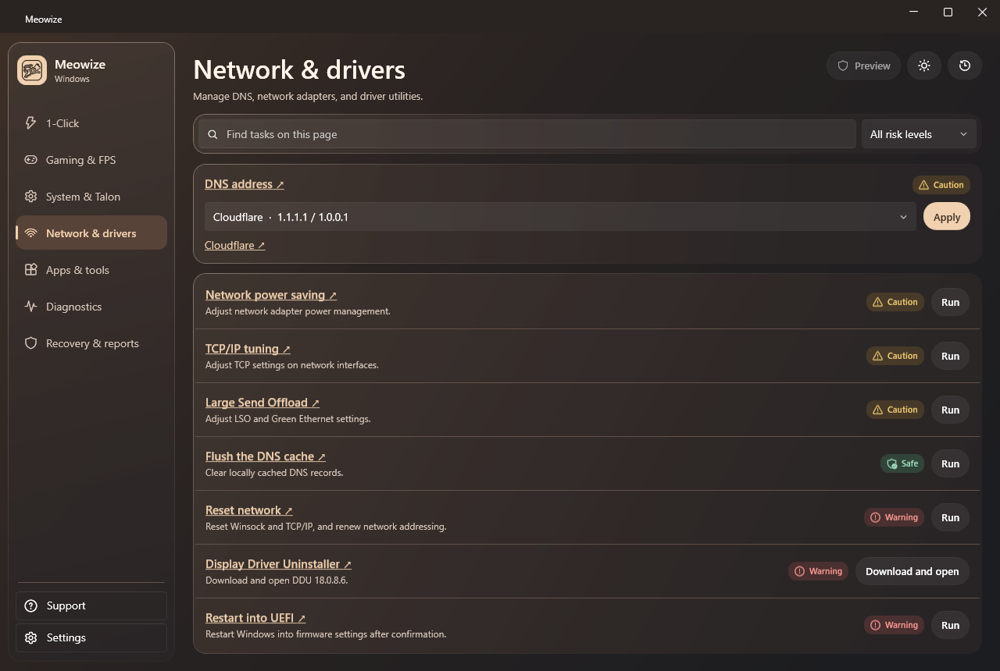

<h1 align="center">
  
</h1>

🇺🇸 [English](../README.md) · 🇻🇳 [Tiếng Việt](README.vi.md) · 🇯🇵 [日本語](README.ja.md) · 🇰🇷 **한국어** · 🇨🇳 [简体中文](README.zh-CN.md)

**Windows 11 x64** · 포터블 ZIP · **1-Click 작업 51개** · **개별 도구 66개**

Meowize는 **VALORANT**, **Counter-Strike 2**, **Overwatch** 같은 게임에서 FPS와 프레임 시간의 안정성을 조정할 수 있는 무료 Windows 도구입니다. 게임 설정을 검토하고 드라이버와 앱을 설치하며 네트워크 옵션을 한곳에서 관리할 수 있습니다.

## 시작하기

1. Windows x64 ZIP을 다운로드합니다. [최신 릴리스](https://github.com/Fuzuto/Meowize-Optimize/releases/latest)
2. ZIP 전체를 풀고 `Meowize.exe`를 실행합니다. .NET Desktop Runtime이 포함되어 있습니다.
3. 지역을 선택한 뒤 **1-Click**에서 **Gaming**을 선택합니다. **검토 후 실행**에서 선택한 작업과 영향을 확인할 수 있습니다.

압축을 푼 폴더에서 PowerShell로 `.\Meowize.exe --preview`를 실행하면 작업을 시뮬레이션할 수 있습니다. 실제 변경 전에는 **복구 및 보고서 → 시스템 스냅샷**에서 복원 지점과 레지스트리 백업을 만들 수 있습니다.

v1.4.0부터 작업 옆 **ⓘ 작동 방식**을 눌러 실행 방법, 변경되는 설정과 파일, 관리자 권한과 다시 시작 필요 여부를 확인할 수 있습니다. 일괄 작업 검토 화면에도 실행 순서대로 같은 내용이 표시됩니다. [전체 117개 작업 안내](features.ko.md)

## 게임 및 FPS

**Gaming** 프리셋은 **51개 중 36개** 작업을 포함합니다. 개별 효과를 비교하려면 **게임 및 FPS**에서 한 항목씩 적용해 보세요.

| 앱의 항목 | 변경 내용 |
| --- | --- |
| **마우스 및 키보드 버퍼** | `MouseDataQueueSize`와 `KeyboardDataQueueSize`를 `20`으로 설정합니다. 현재 계정의 게임 모드를 켜고 `HwSchMode = 2`로 HAGS를 요청합니다. [Microsoft 입력 장치 클래스 드라이버 문서](https://learn.microsoft.com/en-us/windows-hardware/drivers/hid/keyboard-and-mouse-hid-client-drivers) |
| **CPU 코어 파킹 해제** | 현재 전원 관리 옵션에서 파킹되지 않는 코어의 최소 비율을 100%로 설정합니다. [Microsoft 코어 파킹 문서](https://learn.microsoft.com/en-us/windows-hardware/customize/power-settings/options-for-core-parking-cpmincores) |
| **FPS Boost 프로필** | 성능용 전원 설정과 부팅 설정을 포함한 변경을 적용합니다. 실행 전에 **경고**의 세부 내용을 확인하세요. |
| **게임 CPU 우선순위** | VALORANT, CS2, Overwatch 등 지정된 게임 실행 파일의 CPU 우선순위를 설정합니다. |

이 작업만 실행하려면 **게임 및 FPS → 마우스 및 키보드 버퍼**에서 세부 내용을 살펴보고 **실행**을 누르세요. **1-Click → 게임 및 지연 시간**에도 있습니다. Windows를 다시 시작한 뒤 마우스와 키보드를 확인하세요.

### FPS와 프레임 시간 측정

| 목표 FPS | 60 | 144 | 240 | 360 |
| --- | ---: | ---: | ---: | ---: |
| 프레임당 시간 | 16.67 ms | 6.94 ms | 4.17 ms | 2.78 ms |

표는 `1,000 ÷ FPS`로 계산한 기준입니다. 변경 전후에 같은 연습 경로나 리플레이를 같은 해상도, 그래픽 설정 및 FPS 제한으로 **60초** 동안 기록하세요. 설정을 하나씩 바꾸면서 평균 FPS, 1% low, 프레임 시간 급증을 비교합니다. 전원 관리 옵션을 비교할 때는 CPU 온도도 기록하세요. [Intel PresentMon](https://github.com/GameTechDev/PresentMon)

## 드라이버와 앱 빠르게 설치

| 선택할 항목 | 설치 내용 |
| --- | --- |
| **앱 및 도구 → NVIDIA WHQL → 설치** | NVIDIA에서 선택한 설치 파일을 다운로드하고 게시자 서명을 확인한 뒤 실행합니다. 지원 제품 목록에서 GPU를 확인하세요. [581.80 WHQL](https://www.nvidia.com/en-us/drivers/details/257497/) · [566.36 WHQL](https://www.nvidia.com/en-us/drivers/details/237719/) |
| **앱 및 도구 → WinGet으로 앱 3개 설치** | Google Chrome, Discord, 7-Zip을 한 번에 설치합니다. WinGet은 Windows 앱 설치 관리자에 포함되어 있습니다. [WinGet 문서](https://learn.microsoft.com/en-us/windows/package-manager/winget/) |
| **1-Click → WinGet으로 앱 6개 설치** | 위 세 앱에 UniKey, UltraViewer, Zalo를 추가합니다. |

설치 화면 보기

## 네트워크와 버퍼블로트

**네트워크 및 드라이버**에서 DNS 5종, TCP/IP, 어댑터 전원 설정 및 연결 복구 도구를 사용할 수 있습니다. 예를 들어 Cloudflare **1.1.1.1 / 1.0.0.1**을 고르고 **적용**을 누르면 활성 어댑터의 IPv4 DNS가 설정됩니다. [Cloudflare DNS 주소](https://developers.cloudflare.com/1.1.1.1/ip-addresses/)

버퍼블로트는 같은 연결에서 유휴 상태와 업로드 또는 다운로드 중의 지연 시간을 비교해 확인할 수 있습니다. 예를 들어 **18 ms**에서 부하 중 **74 ms**로 늘면 차이는 **+56 ms**입니다. 라우터에서 혼잡이 발생한다면 Smart Queue Management(SQM) 지원 여부를 확인하고 조정한 뒤 다시 측정하세요. [IETF 큐 관리 권고](https://datatracker.ietf.org/doc/html/rfc7567)

DNS와 어댑터 설정 화면 보기

## 실행 전 검토 및 설정

**🟢 안전**은 읽기와 내보내기처럼 영향이 적은 작업, **🟡 주의**는 설정이나 파일 등 변경 작업, **🔴 경고**는 드라이버 변경, 부팅 설정, 재시작 등 영향이 큰 작업에 표시됩니다. 항목 이름의 **↗**을 누르면 관련 자료가 열립니다.

Meowize는 GPU, WinGet, 활성 네트워크 어댑터 등의 조건을 확인합니다. 흐리게 표시된 항목에 마우스를 올리면 이유가 표시됩니다. **사용할 수 없는 이유 ↗**가 표시되면 관련 안내를 열 수 있습니다. 프리셋은 흐리게 표시된 항목을 건너뜁니다.

첫 지역 선택 화면에서는 영어가 기본값입니다. **설정**에서 언어를 바꾸고 해 또는 달 버튼으로 테마를 전환할 수 있습니다. **X**와 **Alt+F4** 모두 종료 시 저장 설정을 따릅니다.

## 빌드 및 라이선스

Windows에서 .NET 10 SDK를 사용합니다. [빌드 및 테스트 안내](../README.md#build-from-source)

**Lê Hiếu Trung (FuryZ)**가 프로젝트를 관리합니다. MIT 라이선스는 Meowize에 새로 기여된 부분에 적용됩니다. [GitHub](https://github.com/Fuzuto) · [MIT 라이선스](../LICENSE)
