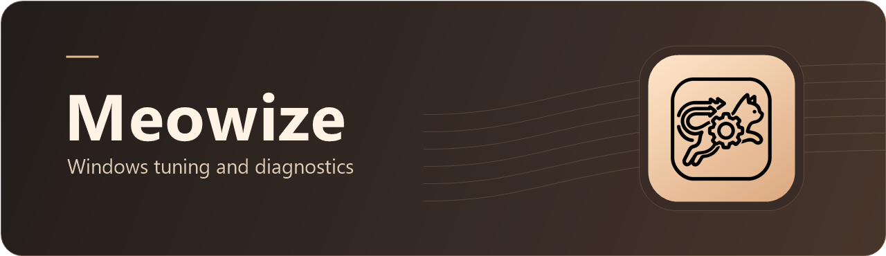
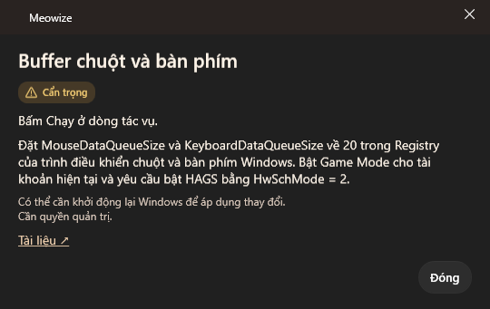
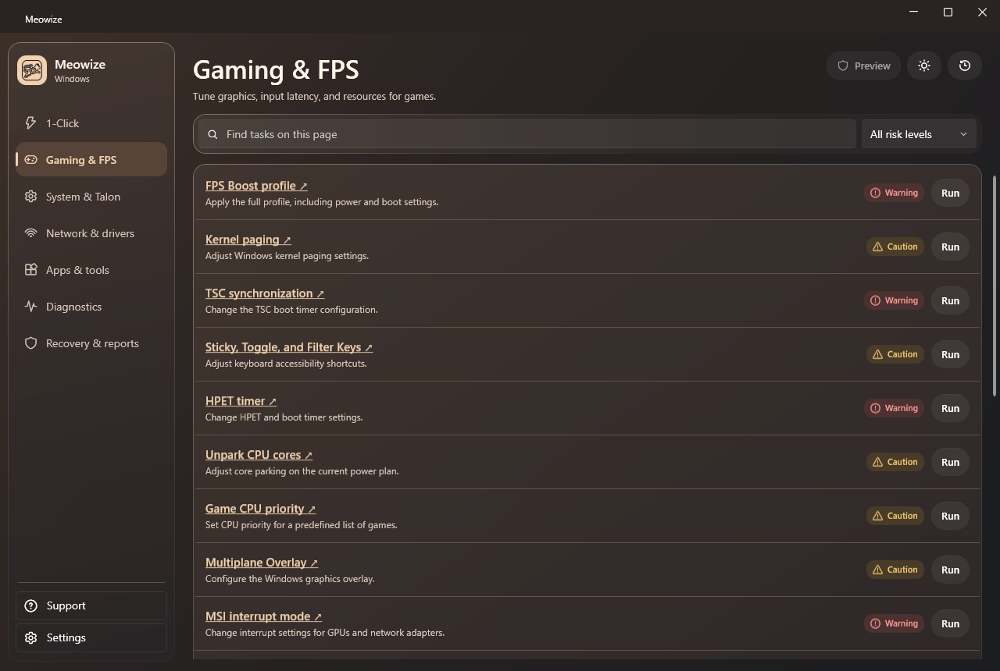
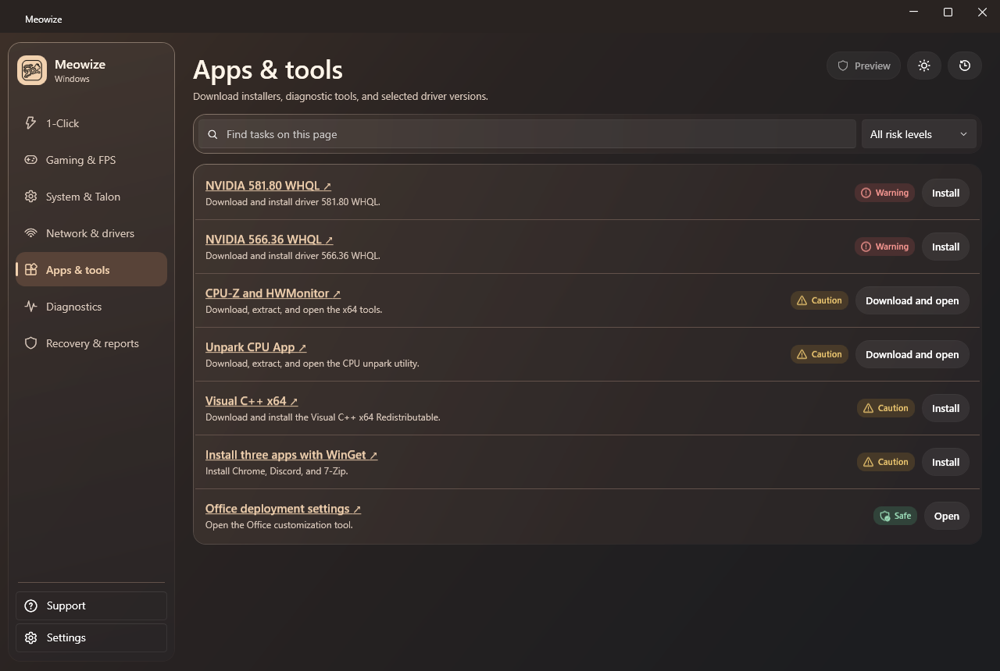
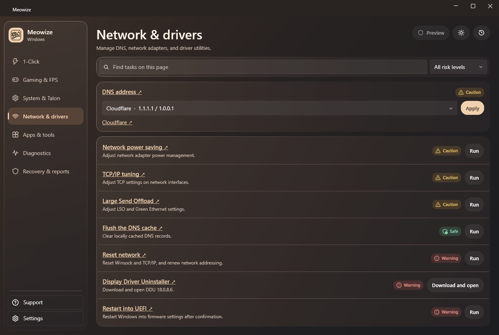

<h1 align="center">
  
</h1>

🇺🇸 [English](../README.md) · 🇻🇳 **Tiếng Việt** · 🇯🇵 [日本語](README.ja.md) · 🇰🇷 [한국어](README.ko.md) · 🇨🇳 [简体中文](README.zh-CN.md)

**Windows 11 x64** · ZIP chạy trực tiếp · **51 tác vụ 1-Click** · **66 công cụ riêng lẻ**

Meowize là công cụ Windows miễn phí dành cho người muốn tối ưu FPS và giữ nhịp khung hình ổn định trong **VALORANT**, **Counter-Strike 2** và **Overwatch**. Bạn có thể xem từng thiết lập trước khi áp dụng, cài nhanh driver và ứng dụng, rồi kiểm tra cấu hình mạng ngay trong cùng giao diện.

## Bắt đầu

1. Tải bản ZIP Windows x64. [Bản phát hành mới nhất](https://github.com/Fuzuto/Meowize-Optimize/releases/latest)
2. Giải nén toàn bộ ZIP rồi mở `Meowize.exe`. Gói đã kèm .NET Desktop Runtime.
3. Chọn vùng, mở **1-Click** và chọn **Gaming**. Bấm **Xem và chạy** để đọc danh sách tác vụ và tác động trước khi xác nhận.

Chạy `.\Meowize.exe --preview` trong PowerShell tại thư mục đã giải nén để thử với tác vụ mô phỏng. Trước khi thay đổi thật, **Cứu hộ & Báo cáo → Snapshot hệ thống** có thể tạo điểm khôi phục và bản sao Registry.

Từ bản v1.4.0, bấm **ⓘ Cách hoạt động** cạnh mỗi mục để xem nút cần bấm, thiết lập hoặc tệp bị thay đổi, quyền quản trị và yêu cầu khởi động lại. Màn xem lại 1-Click cho biết các thay đổi theo thứ tự chạy. [Hướng dẫn đủ 117 tác vụ](features.vi.md)

## Gaming và FPS

Preset **Gaming** gồm **36 trên 51** tác vụ cho hệ thống, game, mạng và dọn dẹp. Mở **Gaming & FPS** để thử từng mục khi cần đo riêng tác động của một thay đổi.

| Trong Meowize | Thiết lập được áp dụng |
| --- | --- |
| **Buffer chuột và bàn phím** | Đặt `MouseDataQueueSize` và `KeyboardDataQueueSize` về `20`, bật Game Mode cho tài khoản hiện tại và yêu cầu HAGS bằng `HwSchMode = 2`. [Tài liệu trình điều khiển chuột và bàn phím của Microsoft](https://learn.microsoft.com/en-us/windows-hardware/drivers/hid/keyboard-and-mouse-hid-client-drivers) |
| **Unpark CPU** | Yêu cầu mức tối thiểu **100%** lõi CPU không bị park trong gói điện đang dùng. [Tài liệu core parking của Microsoft](https://learn.microsoft.com/en-us/windows-hardware/customize/power-settings/options-for-core-parking-cpmincores) |
| **FPS Boost** | Áp dụng một nhóm tinh chỉnh gồm gói điện hiệu năng và cấu hình khởi động. Đọc chi tiết **Cảnh báo** trước khi chạy. |
| **Ưu tiên CPU cho game** | Đặt độ ưu tiên CPU cho danh sách tiến trình có sẵn, trong đó có VALORANT, CS2 và Overwatch. |

Để chạy riêng, mở **Gaming & FPS → Buffer chuột và bàn phím**, xem chi tiết rồi bấm **Chạy** và xác nhận. Trong batch, mục này nằm ở **1-Click → Gaming và độ trễ**. Khởi động lại Windows rồi thử cả chuột lẫn bàn phím.

Xem hộp chi tiết Buffer chuột trong Meowize

### Đo FPS và thời gian khung hình

| FPS mục tiêu | 60 | 144 | 240 | 360 |
| --- | ---: | ---: | ---: | ---: |
| Thời gian mỗi khung hình | 16,67 ms | 6,94 ms | 4,17 ms | 2,78 ms |

Bảng trên tính theo `1.000 ÷ FPS` để làm mốc tham chiếu. Khi so sánh trước và sau, ghi lại cùng một đoạn **60 giây** trong phòng tập hoặc replay, giữ nguyên độ phân giải, đồ họa và giới hạn FPS. Thay đổi từng mục rồi so FPS trung bình, 1% low và các đỉnh thời gian khung hình. Theo dõi nhiệt độ CPU khi thử các gói điện khác nhau. [Intel PresentMon](https://github.com/GameTechDev/PresentMon)

## Cài nhanh driver và ứng dụng

| Chọn trong app | Bạn nhận được gì |
| --- | --- |
| **Ứng dụng & Công cụ → NVIDIA WHQL → Cài đặt** | Meowize tải bộ cài đã chọn từ NVIDIA và kiểm tra chữ ký nhà phát hành trước khi chạy. Đối chiếu GPU với danh sách hỗ trợ của NVIDIA. [581.80 WHQL](https://www.nvidia.com/en-us/drivers/details/257497/) · [566.36 WHQL](https://www.nvidia.com/en-us/drivers/details/237719/) |
| **Ứng dụng & Công cụ → Cài 3 ứng dụng qua Winget** | Cài Google Chrome, Discord và 7-Zip trong một lượt. WinGet đi kèm Windows App Installer. [Tài liệu WinGet](https://learn.microsoft.com/en-us/windows/package-manager/winget/) |
| **1-Click → Cài 6 ứng dụng qua Winget** | Thêm UniKey, UltraViewer và Zalo vào bộ ba trên. |

Xem các nút cài đặt trong Meowize

## Mạng và bufferbloat

**Mạng & Driver** có năm lựa chọn DNS, tinh chỉnh TCP/IP, quản lý điện năng của card mạng và công cụ khôi phục kết nối. Ví dụ, chọn Cloudflare **1.1.1.1 / 1.0.0.1** rồi bấm **Áp dụng** để đặt DNS IPv4 cho các adapter đang hoạt động. [Địa chỉ DNS Cloudflare](https://developers.cloudflare.com/1.1.1.1/ip-addresses/)

Để đo bufferbloat, so ping khi đường truyền rảnh với ping lúc đang tải xuống hoặc tải lên trên cùng kết nối. Chẳng hạn, **18 ms khi rảnh** và **74 ms khi có tải** là mức tăng **+56 ms**. Nếu nghẽn xảy ra tại router, hãy kiểm tra tùy chọn Smart Queue Management (SQM) của router rồi đo lại sau khi chỉnh. [Khuyến nghị quản lý hàng đợi của IETF](https://datatracker.ietf.org/doc/html/rfc7567)

Xem phần DNS và cấu hình card mạng

## Kiểm tra trước khi chạy

**🟢 An toàn** dành cho thao tác ảnh hưởng thấp như đọc hoặc xuất dữ liệu. **🟡 Cẩn trọng** đánh dấu thay đổi thiết lập, tệp hoặc ứng dụng. **🔴 Cảnh báo** dành cho tác vụ có tác động lớn hơn như cài driver, sửa cấu hình khởi động hoặc khởi động lại. Bấm tên mục có dấu **↗** để mở tài liệu tham khảo.

Meowize kiểm tra điều kiện như GPU, WinGet và adapter mạng đang hoạt động. Rê chuột lên mục bị làm mờ để đọc lý do. Nếu có tài liệu liên quan, bấm **Vì sao mục này không khả dụng ↗** để xem hướng dẫn. Preset bỏ qua các mục bị làm mờ.

Màn chọn vùng dùng tiếng Anh mặc định. Đổi ngôn ngữ trong **Cài đặt** và chuyển giao diện sáng hoặc tối bằng nút mặt trời hoặc mặt trăng. **X** và **Alt+F4** dùng cùng lựa chọn lưu khi thoát.

Sao lưu, quyền quản trị và thiết lập nâng cao

- Snapshot Registry mới nằm trong `C:\Meowize_Backup`. Trang **Cứu hộ & Báo cáo** cũng đọc được snapshot cũ tương thích. Sao lưu nhánh ưu tiên `D:\Meowize_Backup`, hoặc dùng thư mục `BranchExports` trong thư mục sao lưu trên ổ C.
- Nút **Quản trị** mở app qua UAC và chuyển tiếp trang, các mục đang chọn, DNS và tùy chọn tắt máy. Có thể dừng batch sau tác vụ hiện tại hoặc hủy đếm ngược tắt máy. **Ctrl+L** hiện hoặc ẩn nhật ký.
- Acrylic hoạt động trên Windows 11 từ build 22621 khi bật hiệu ứng trong suốt. [Tài liệu Windows DWM](https://learn.microsoft.com/en-us/windows/win32/api/dwmapi/ne-dwmapi-dwm_systembackdrop_type)
- KeyGate mặc định tắt. Để bật, đặt `keygate.json` cạnh EXE với `offline.salt` từ 16–64 byte và `offline.hash` dài 32 byte, đều ở dạng Base64. Hash dùng PBKDF2-SHA256 với 210.000 vòng trên mật khẩu đã bỏ khoảng trắng ở hai đầu. `onlineUrl` là tùy chọn HTTPS trả về object có `salt` và `hash`. Tùy chọn ghi nhớ dùng DPAPI cho tài khoản Windows hiện tại.

## Build và giấy phép

Dùng .NET 10 SDK trên Windows. Hướng dẫn build và kiểm thử có trong README tiếng Anh. [Build từ mã nguồn](../README.md#build-from-source)

**Lê Hiếu Trung (FuryZ)** bảo trì dự án. Giấy phép MIT áp dụng cho phần đóng góp mới của Meowize. [GitHub](https://github.com/Fuzuto) · [Giấy phép MIT](../LICENSE)
