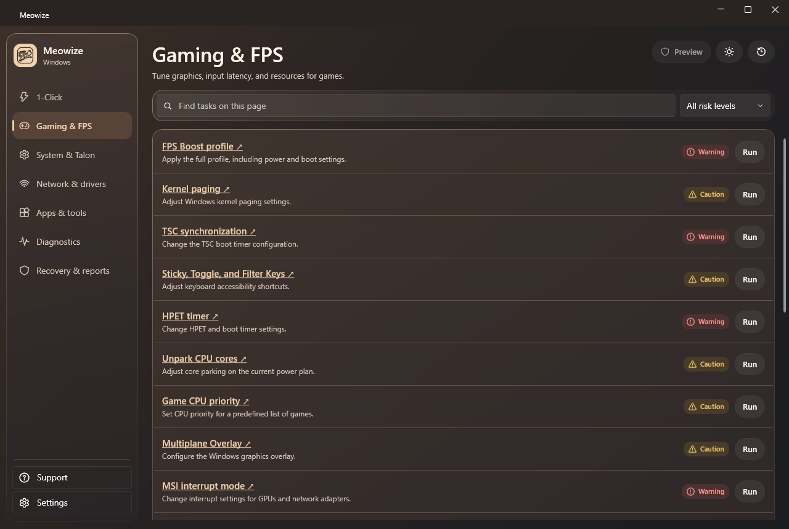
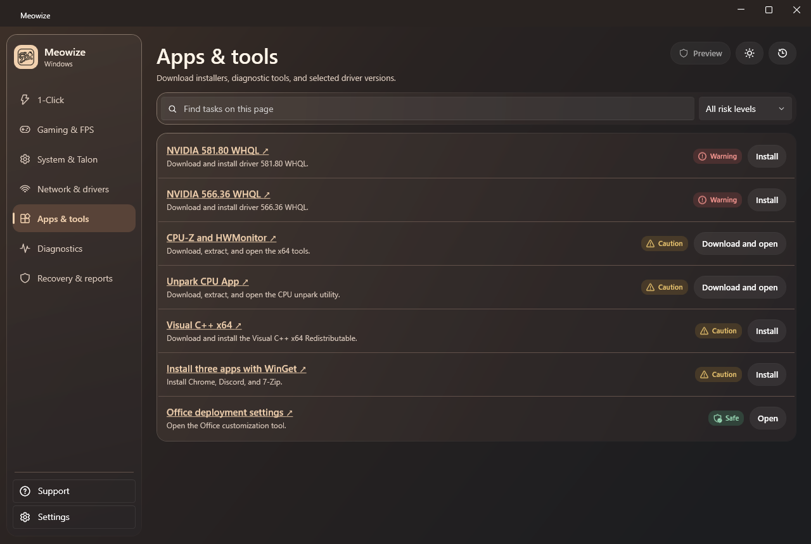
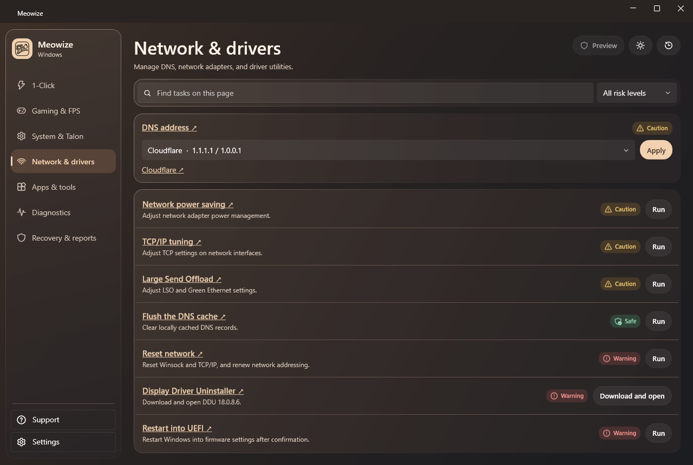

<h1 align="center">
  
</h1>

🇺🇸 [English](../README.md) · 🇻🇳 [Tiếng Việt](README.vi.md) · 🇯🇵 [日本語](README.ja.md) · 🇰🇷 [한국어](README.ko.md) · 🇨🇳 **简体中文**

**Windows 11 x64** · 便携版 ZIP · **51 项一键任务** · **66 项独立工具**

Meowize 是一款免费的 Windows 工具，面向 **VALORANT**、**Counter-Strike 2** 和 **Overwatch** 等游戏的帧率与帧时间调优。你可以在一个界面中检查游戏设置、安装驱动和常用应用，以及调整网络选项。

## 快速开始

1. 下载 Windows x64 ZIP。 [最新发行版](https://github.com/Fuzuto/Meowize-Optimize/releases/latest)
2. 完整解压 ZIP，再运行 `Meowize.exe`。压缩包已包含 .NET Desktop Runtime。
3. 选择地区，在 **1-Click** 中选择 **Gaming**。通过 **检查并运行** 查看选中的任务及其影响。

在解压后的目录中用 PowerShell 运行 `.\Meowize.exe --preview`，即可体验模拟任务。实际修改前，可用 **恢复与报告 → 系统快照** 创建还原点和注册表备份。

在 `main` 分支构建的版本中，点击任务旁的 **ⓘ 工作原理**，即可查看使用步骤、会修改的设置和文件，以及是否需要管理员权限或重启。批量检查页面也会按运行顺序显示这些改动。 [全部 117 项功能指南](features.zh-CN.md)

## 游戏与 FPS

**Gaming** 预设包含 **51 项中的 36 项**，涵盖系统、游戏、网络和清理。要比较某项改动的效果，可在 **游戏与 FPS** 中逐项尝试。

| 应用内选项 | 作用 |
| --- | --- |
| **鼠标和键盘缓冲区** | 将 `MouseDataQueueSize` 和 `KeyboardDataQueueSize` 设为 `20`，为当前账户启用游戏模式，并通过 `HwSchMode = 2` 请求启用 HAGS。 [Microsoft 鼠标与键盘类驱动文档](https://learn.microsoft.com/en-us/windows-hardware/drivers/hid/keyboard-and-mouse-hid-client-drivers) |
| **取消 CPU 核心停放** | 将当前 Windows 电源计划中未停放核心的最低比例设置为 100%。 [Microsoft 核心停放文档](https://learn.microsoft.com/en-us/windows-hardware/customize/power-settings/options-for-core-parking-cpmincores) |
| **FPS Boost 配置** | 应用包含性能电源设置和启动设置的一组改动。运行前请查看 **警告** 详情。 |
| **游戏 CPU 优先级** | 为预设列表中的游戏进程设置 CPU 优先级，其中包括 VALORANT、CS2 和 Overwatch。 |

如需单独执行，打开 **游戏与 FPS → 鼠标和键盘缓冲区**，检查详情后点击 **运行** 并确认。也可在 **1-Click → 游戏与延迟** 中找到该任务。重启 Windows 后检查鼠标和键盘。

### 测量帧率和帧时间

| 目标 FPS | 60 | 144 | 240 | 360 |
| --- | ---: | ---: | ---: | ---: |
| 每帧时间 | 16.67 ms | 6.94 ms | 4.17 ms | 2.78 ms |

表中的参考值按 `1,000 ÷ FPS` 计算。对比前后效果时，保持相同的分辨率、画质和帧率上限，在同一训练路线或回放中记录 **60 秒**。每次只调整一个设置，对比平均帧率、1% low 和帧时间尖峰。比较电源计划时也可记录 CPU 温度。 [Intel PresentMon](https://github.com/GameTechDev/PresentMon)

## 快速安装驱动和应用

| 选择的操作 | 安装内容 |
| --- | --- |
| **应用与工具 → NVIDIA WHQL → 安装** | 从 NVIDIA 下载选定的安装程序，验证发布者签名后运行。可在 NVIDIA 的支持产品列表中核对 GPU。 [581.80 WHQL](https://www.nvidia.com/en-us/drivers/details/257497/) · [566.36 WHQL](https://www.nvidia.com/en-us/drivers/details/237719/) |
| **应用与工具 → 用 WinGet 安装 3 个应用** | 一次安装 Google Chrome、Discord 和 7-Zip。WinGet 由 Windows 应用安装程序提供。 [WinGet 文档](https://learn.microsoft.com/en-us/windows/package-manager/winget/) |
| **1-Click → 用 WinGet 安装 6 个应用** | 在上述三款应用的基础上添加 UniKey、UltraViewer 和 Zalo。 |

查看安装界面

## 网络与缓冲膨胀

**网络与驱动** 提供五个 DNS 选项、TCP/IP 调整、网卡电源设置和连接修复工具。例如选择 Cloudflare **1.1.1.1 / 1.0.0.1** 后点击 **应用**，即可为活动网卡设置 IPv4 DNS。 [Cloudflare DNS 地址](https://developers.cloudflare.com/1.1.1.1/ip-addresses/)

要观察缓冲膨胀，可比较同一连接在空闲和上传或下载时的延迟。例如，空闲为 **18 ms**，负载下为 **74 ms**，延迟增加 **+56 ms**。若拥塞发生在路由器，查看它是否支持智能队列管理（SQM），调整后再次测量。 [IETF 队列管理建议](https://datatracker.ietf.org/doc/html/rfc7567)

查看 DNS 和网卡设置

## 检查任务和个性化

**🟢 安全** 用于读取、导出等影响较小的操作。**🟡 注意** 标记对设置、文件或应用的改动。**🔴 警告** 标记驱动安装、启动设置和重启等影响较大的操作。点击任务名称旁的 **↗** 可查看相关资料。

从 `main` 构建的版本会检查 GPU、WinGet 和活动网络适配器等条件。将鼠标悬停在灰显的任务上即可看到原因。如果显示 **查看不可用的原因 ↗**，可以打开相关指南。预设会选中满足条件的任务。

首次选择地区时默认为英语，可在 **设置** 中切换语言。点击太阳或月亮按钮切换主题，通过 **X** 或 **Alt+F4** 退出时会沿用保存偏好。

## 构建和许可证

在 Windows 上使用 .NET 10 SDK。 [构建和测试步骤](../README.md#build-from-source)

项目由 **Lê Hiếu Trung (FuryZ)** 维护。MIT 许可证适用于 Meowize 的新增贡献。 [GitHub](https://github.com/Fuzuto) · [MIT 许可证](../LICENSE)
